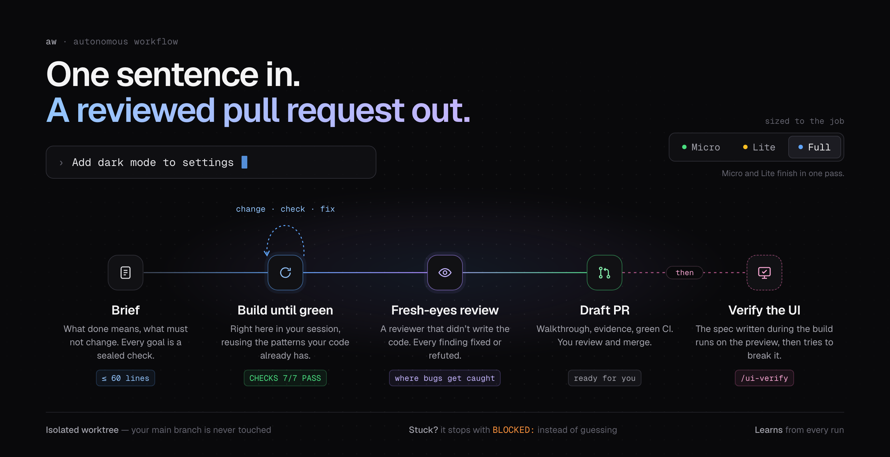

# Agent Skills

> An opinionated workflow for coding agents — my own way of working, current best practices, and lessons from real projects — kept only where evals show it helps.

[](LICENSE)
[](https://agentskills.io/)
[](#skills)
[](#skills)
[](https://claude.com/claude-code)

These skills encode how I build software with agents: scope the task, build against checks, get a second pair of eyes on the diff, prove the UI works, and keep CI green.
Each one is run with and without itself; a skill that doesn't change the outcome gets cut.
They install into Claude Code, Cursor, Codex, Gemini CLI, Copilot, Windsurf, OpenCode, and any other [Agent Skills](https://agentskills.io)-compatible tool.

```bash
git clone https://github.com/mthines/agent-skills.git
cd agent-skills && bash scripts/sync-symlinks.sh
```

## What you get

<table>
<tr>
<td width="50%" valign="top">

### 🚀 Ship a feature from one sentence

`aw` scopes the job, writes a short brief with sealed checks, builds until they pass, gets a fresh-eyes review, and opens a draft PR.

```text
Add dark mode, all the way to a PR
```

[`aw`](#featured-autonomous-workflow) · [`autonomous-workflow`](./skills/workflow/autonomous-workflow/SKILL.md)

</td>
<td width="50%" valign="top">

### 🐛 Fix a bug from whatever you have

A stack trace, a span URL, a screen recording, a ticket, or a hunch: it reproduces the bug, traces the root cause, fixes it behind a failing test, and opens a draft PR.

```text
/fix-bug <stack trace>
```

[`fix-bug`](./skills/workflow/fix-bug/SKILL.md) · [`video-analyser`](./skills/analysis/video-analyser/SKILL.md)

</td>
</tr>
<tr>
<td valign="top">

### 🔍 Reviews that catch real bugs

Independent finders flag, a verifier filters, and only grounded findings reach your PR. `review-loop` then fixes or answers every thread until the PR converges; with no PR yet, it reviews the local branch.

```text
/pr-review 42
/review-loop
```

[`pr-reviewer`](./agents/pr-reviewer.md) · [`review-loop`](./skills/quality/review-loop/SKILL.md)

</td>
<td valign="top">

### ✅ Proof the UI actually works

The brief's spec runs on your local stack or the preview and tries to break the change. Then the telemetry is read back to check that every click reached the API and the database the way it should. Screenshots and recordings are attached. Run `setup` once per repo; it commits `.agents/aw/`.

```text
/aw-verify setup
/aw-verify preview 42
```

[`aw-verify`](./skills/testing/aw-verify/SKILL.md) · [`ui-verify`](./skills/testing/ui-verify/SKILL.md) · [`telemetry-verify`](./skills/testing/telemetry-verify/SKILL.md)

</td>
</tr>
<tr>
<td valign="top">

### 🎨 Product craft, not just code

Audits walk the user's real path before checking contrast; visual direction, motion, charts, and behaviour change get the same rigor. Never a dark pattern.

```text
Review the UX of the onboarding flow
```

[`ux`](./skills/design/ux/SKILL.md) · [`visual-design`](./skills/design/visual-design/SKILL.md) · [`animations`](./skills/design/animations/SKILL.md) · [`charting`](./skills/design/charting/SKILL.md)

</td>
<td valign="top">

### 🚢 Merge-ready, every time

A narrative PR description, a simplify pass that cuts noise without changing behaviour, CI fixes that never weaken a check, and telemetry that proves the change landed.

```text
/create-pr
/ci-auto-fix
```

[`create-pr`](./skills/delivery/create-pr/SKILL.md) · [`polish`](./skills/quality/polish/SKILL.md) · [`ci-auto-fix`](./skills/delivery/ci-auto-fix/SKILL.md) · [`measurable`](./skills/quality/measurable/SKILL.md)

</td>
</tr>
</table>

Most skills trigger from plain language — describe what you want. The rest are slash commands you type when you want them.

## Measured, not assumed

Every skill here has to earn its place in the context window.
Each one is run with and without itself on hard, real-usage cases; skills that changed nothing were deleted or folded into the skill that calls them.

- **Over 400 KB less prompt.** Seven skills and three agents cut; the reviewer's prompt went from 202 KB to 60 KB; skill descriptions from 44k to 17k characters.
- **`aw` beats a plain Claude Code run.** On three real tickets, each pair blind-judged by two independent reviewers, `aw` won 10 of 12 judgements — 8 of 8 since its current design. Every win came from a defect its fresh-eyes review caught that the plain run shipped. It costs about 1.5–2× a plain run, so reach for it when a missed bug costs more than that.
- **`/polish simplify` went from 0.73 to 1.00** on planted-defect evals, and the rewritten `ux` ranked first on 3 of 3 real audits against both the old skill and no skill.

The `aw` runs used Claude Opus 5.5. Method and every run: [PR #241](https://github.com/mthines/agent-skills/pull/241).

## Featured: autonomous workflow



```text
Implement a dark-mode toggle independently
Add user authentication end-to-end
Refactor the API client to use retry logic — handle it in isolation
```

1. **Sizes the job.** Micro (one file) and Lite (a small change) finish in one pass; Full gets the loop below.
2. **Writes a short brief.** At most 60 lines: what done means, what must not change, and one sealed, runnable check per goal.
3. **Builds until green.** In your session, in its own Git worktree, looping until the checks print `CHECKS n/n PASS`.
4. **Gets a fresh-eyes review.** A reviewer that did not write the code reads the diff; every finding is fixed or rejected with evidence.
5. **Opens a draft PR** with a walkthrough and evidence, then gets CI green. Stuck after five attempts, it stops with `BLOCKED:` instead of guessing.
6. **Proves it works.** With `.agents/aw/` set up, [`/aw-verify`](./skills/testing/aw-verify/SKILL.md) runs the brief's specs on your local stack, tries to break the change, and reads the telemetry back: each criterion is traced from the web event to the API to the database. A `telemetry:` criterion in the brief must be confirmed before the run counts as done.

Every run prints a paste-ready `/goal` line to let the session drive itself to done, and records what it learned for the next run.
How it works inside: [`full-tier.md`](./skills/workflow/autonomous-workflow/aw/rules/full-tier.md) · [design notes](./skills/workflow/autonomous-workflow/CLAUDE.md).

## Skills

| Skill | What it does |
| ----- | ------------ |
| **`workflow/`** | *End-to-end orchestrators* |
| [`aw`](./skills/workflow/autonomous-workflow/aw/SKILL.md) | Ships a task end to end: brief, build until green, fresh-eyes review, draft PR. |
| [`/fix-bug`](./skills/workflow/fix-bug/SKILL.md) | Fixes one bug from a stack trace, span, recording, or ticket, behind a failing test. |
| [`/implement-suggestion`](./skills/workflow/implement-suggestion/SKILL.md) | Applies PR review comments, one commit each, and resolves the threads. |
| **`quality/`** | *Code, tests, plans, AI apps* |
| [`/pr-review`](./skills/quality/pr-review/SKILL.md) | One read-only review of a PR: a single report plus inline findings. |
| [`/review-loop`](./skills/quality/review-loop/SKILL.md) | Reviews, fixes, and resolves a PR's threads until it converges; with no PR, it does the same on the local branch. |
| [`/optimize-approach`](./skills/quality/optimize-approach/SKILL.md) | Asks whether a change or plan takes the best approach, and names a better one only when it clearly wins. |
| [`/polish`](./skills/quality/polish/SKILL.md) | Pre-PR cleanup: simplifies the changed code and prunes noise comments. |
| [`impact-map`](./skills/quality/impact-map/SKILL.md) | An impact-first view of a PR: a verdict, one colored diagram, and the decisions a reviewer must make. |
| [`critical`](./skills/quality/critical/SKILL.md) | A hostile pre-mortem of a plan or diff, with a steelman alternative. |
| [`confidence`](./skills/quality/confidence/SKILL.md) | Scores how sure you can be that the work meets the requirement. |
| [`tdd`](./skills/quality/tdd/SKILL.md) | Strict red-green-refactor, then checks each test really exercises the production code. |
| [`measurable`](./skills/quality/measurable/SKILL.md) | Ships each change with the telemetry that proves it worked. |
| [`/ai-engineering`](./skills/quality/ai-engineering/SKILL.md) | Reviews an LLM app: prompts, RAG, agents, evals, safety, cost. |
| **`delivery/`** | *Git, PR, CI* |
| [`/create-pr`](./skills/delivery/create-pr/SKILL.md) | Writes a short PR story, opens a draft, and drives review and CI to green. |
| [`/ci-auto-fix`](./skills/delivery/ci-auto-fix/SKILL.md) | Diagnoses red CI and fixes it — never by weakening a check. |
| [`/resolve-conflicts`](./skills/delivery/resolve-conflicts/SKILL.md) | Resolves merge and rebase conflicts; asks on the ambiguous ones. |
| [`/attach-media`](./skills/delivery/attach-media/SKILL.md) | Uploads screenshots and recordings into a PR so they render inline. |
| [`/github-actions-author`](./skills/delivery/github-actions-author/SKILL.md) | Writes and reviews fast, cheap GitHub Actions workflows. |
| **`testing/`** | *UI verification and end-to-end tests* |
| [`/aw-verify`](./skills/testing/aw-verify/SKILL.md) | Proves a feature works on your local stack or the preview — browser and telemetry — and fixes what fails. `setup` writes the shared `.agents/aw/` config. |
| [`/ui-verify`](./skills/testing/ui-verify/SKILL.md) | Puts a plain-language UI spec in the PR, runs it, then tries to break it. |
| [`telemetry-verify`](./skills/testing/telemetry-verify/SKILL.md) | Reads back what the services recorded during a run and checks each journey from web event to database. |
| [`/e2e-testing`](./skills/testing/e2e-testing/SKILL.md) | Plans, writes, and heals Playwright end-to-end tests. |
| [`/e2e-testing-mobile`](./skills/testing/e2e-testing-mobile/SKILL.md) | Maestro flows for Expo and React Native. |
| **`design/`** | *UI, visual, interaction* |
| [`ux`](./skills/design/ux/SKILL.md) | Walks the user's real path, then accessibility, microcopy, and dark patterns. |
| [`visual-design`](./skills/design/visual-design/SKILL.md) | Brand-aware visual direction: color, type, and hierarchy. |
| [`animations`](./skills/design/animations/SKILL.md) | Performant web motion and perceived performance. |
| [`animations-native`](./skills/design/animations-native/SKILL.md) | Reanimated and gesture motion for React Native. |
| [`charting`](./skills/design/charting/SKILL.md) | Picks the right chart and library for your data. |
| [`storybook`](./skills/design/storybook/SKILL.md) | Stories, playgrounds, and interaction tests per component. |
| [`behavioral-design`](./skills/design/behavioral-design/SKILL.md) | Helps people adopt a new behavior or tool — ethically. |
| **`analysis/`** | *Investigate data, diagnose issues* |
| [`ideate`](./skills/analysis/ideate/SKILL.md) | Research-grounded brainstorming with independent judges. |
| [`interview`](./skills/analysis/interview/SKILL.md) | Aligns on scope before planning; asks only what research can't answer. |
| [`rum-tracking`](./skills/analysis/rum-tracking/SKILL.md) | Decides which product analytics to track, and what is PII. |
| [`video-analyser`](./skills/analysis/video-analyser/SKILL.md) | Pulls bugs and repro steps out of a screen recording. |
| [`/screen-recorder`](./skills/analysis/screen-recorder/SKILL.md) | Records a short, cropped clip of a UI interaction. |
| [`/playwright-trace-analyzer`](./skills/analysis/playwright-trace-analyzer/SKILL.md) | Names the race behind a flaky Playwright test. |
| [`/profile-optimizer`](./skills/analysis/profile-optimizer/SKILL.md) | Turns a React or Chrome performance trace into fixes. |
| [`youtube-transcript`](./skills/analysis/youtube-transcript/SKILL.md) | Fetches a YouTube video's captions as text. |
| **`authoring/`** | *Skills about Claude Code itself* |
| [`docs`](./skills/authoring/docs/SKILL.md) | Writes and audits CLAUDE.md, AGENTS.md, READMEs, and docs trees. |
| [`/create-skill`](./skills/authoring/create-skill/SKILL.md) | Writes a skill from what a real run got wrong; also diagnoses and prunes skills. |
| [`/optimize-claude-md`](./skills/authoring/optimize-claude-md/SKILL.md) | Trims context bloat from CLAUDE.md. |
| [`/handoff`](./skills/authoring/handoff/SKILL.md) | Packs the session into a brief for a fresh agent. |
| [`/persistent-memory`](./skills/authoring/persistent-memory/SKILL.md) | Plain-markdown memory that carries across sessions. |

A `/` name is a slash command; the rest also trigger from plain language.
The skills dispatch five agents of their own: [`pr-reviewer`](./agents/pr-reviewer.md), [`branch-reviewer`](./agents/branch-reviewer.md), [`feature-pr-verifier`](./agents/feature-pr-verifier.md), [`aw-executor`](./skills/workflow/autonomous-workflow/templates/aw-executor.agent.md), and [`aw-tester`](./skills/workflow/autonomous-workflow/templates/aw-tester.agent.md).

## Install

```bash
git clone https://github.com/mthines/agent-skills.git
cd agent-skills && bash scripts/sync-symlinks.sh
```

Every skill is symlinked live into your tool, so `git pull` is the whole upgrade.
No clone? `npx skills add https://github.com/mthines/agent-skills --all --agent claude-code` installs a frozen copy.

Forks, other tools, the VS Code extension, and per-project plug-ins: [`docs/setup.md`](./docs/setup.md).

## Contributing

PRs welcome. Start with [`docs/development.md`](./docs/development.md) and the conventions in [`CLAUDE.md`](./CLAUDE.md).

## License

[MIT](./LICENSE)
