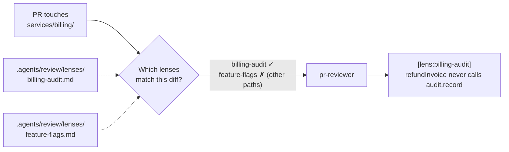
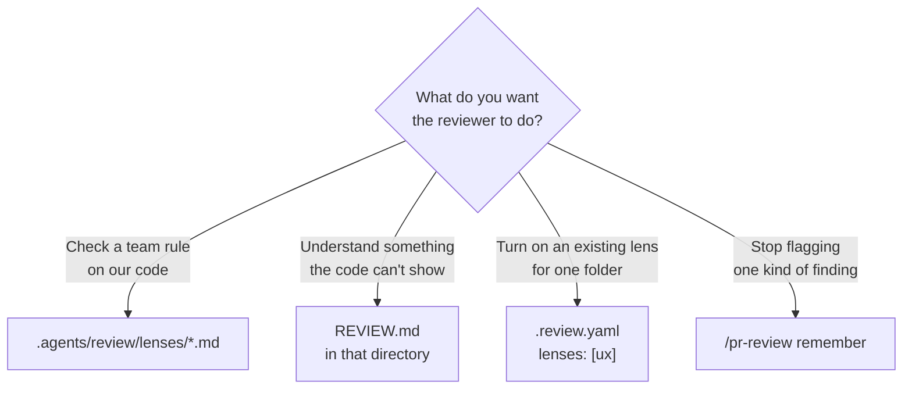

# `/pr-review` — a reviewer that knows your team's rules

> Every team has rules a generic reviewer will never guess.
> Write them down once, in one file, and the AI reviewer checks them on every PR that touches your code.



**No registration.
No config.
No CI change.**
Commit a Markdown checklist to `.agents/review/lenses/`, and from the next PR on, the reviewer applies it wherever your paths change, and nowhere else.

---

## Your first lens in 60 seconds

**1. Create the file** in the repo you want reviewed:

```bash
mkdir -p .agents/review/lenses
$EDITOR .agents/review/lenses/billing-audit.md
```

**2. Paste and edit:**

```markdown
---
applies-to: "services/billing/**"
---

# Billing audit — Review Lens

## Checklist

- [ ] Every new or changed exported function that changes an invoice calls `audit.record("billing.<fn>", { id })` before it returns.
```

**3. Merge it.**
That's it.
The next PR that touches `services/billing/` gets reviewed against your checklist.

> **Optional:** add a `CODEOWNERS` line for the file so your team owns its rules.

---

## What you'll see

The reviewer announces every lens it loads, and why, before it starts:

```text
lens billing-audit: repo lens; applies-to services/billing/** (.agents/review/lenses/billing-audit.md)
```

And when the PR breaks your rule, the finding names the lens that caught it:

```text
services/billing/invoice.mjs:12 — issue: Refund is missing its billing audit record
[lens:billing-audit] `refundInvoice` never calls `audit.record("billing.refundInvoice", { id })`;
running it leaves `audit.all()` empty, so compliance never sees the refund.
```

That is real output from this repo's eval: the reviewer read the lens, then **ran the code** to prove the audit log stayed empty.
A PR that only changed `services/catalog/` in the same repo got no billing finding at all.

---

## When to write a lens

**Wrote the same review comment twice?
That's a lens.**

Good candidates:

- 💸 **Money and compliance** — every charge passes an idempotency key; every refund is audited.
- 🚩 **Feature flags** — every `useFlag(` names a flag declared in `flags.ts`; the off path still works.
- 🔐 **Auth** — every new route goes through `requireRole(`, never a hand-rolled check.
- 📈 **Telemetry** — every new endpoint opens a span named `<service>.<operation>`.
- 🧱 **Architecture** — nothing in `packages/ui/` imports from `apps/`.

A lens is for **house rules a reviewer can check from the diff**.
If a reviewer would need to know your codebase to catch it, and it fits on one line, it belongs in a lens.

---

## Aim it precisely

A lens loads only when its trigger matches.
Every field but `applies-to` is optional.

| Field | What it does | Example |
| --- | --- | --- |
| `applies-to` | Path globs the change must touch; omit it (or write `always`) for the whole repo | `"services/billing/**"` |
| `diff-matches` | Load only when an added line matches one of these regexes | `'charge\(\|refund\('` |
| `min-tier` | Load only on reviews at least this deep: `quick`, `standard`, or `deep` | `deep` |
| `auto` | `false` makes the lens load only when someone names it | `false` |

A sharper trigger means a quieter reviewer.
This lens wakes up only when billing code adds a `charge(` or `refund(` call:

```markdown
---
applies-to: "services/billing/**"
diff-matches: 'charge\(|refund\('
---

# Payments idempotency — Review Lens

## Checklist

- [ ] Every charge or refund call passes an idempotency key derived from the order, never a random UUID.
```

---

## Pick the right lever

Lenses are one of four ways to teach the reviewer about your repo.
Each one is a file you commit, read automatically, with no flag.



| You want the reviewer to… | Write | Example |
| --- | --- | --- |
| check a team rule on your code | `.agents/review/lenses/<name>.md` | "every refund is audited" |
| understand context the code can't show | `REVIEW.md` in that directory | "this service reads only from replicas" |
| run a built-in or name-only lens on one folder | `lenses: [<name>]` in that folder's `.review.yaml` | `lenses: [ux]` in `apps/web/` |
| stop raising one kind of finding | `/pr-review remember <fact>` | "generated files under `gen/` are never edited by hand" |

`REVIEW.md` is context and never changes what gets reported.
A lens is a checklist and produces findings.
Use both.

### Turn a lens on for one folder

```yaml
# apps/web/.review.yaml
lenses:
  - ux                     # a built-in lens
  - payments-idempotency   # or one of your repo lenses
```

Configs merge as a union down the tree: a parent's lenses stay on for every folder below it.

---

## Built-in lenses

These ship with the reviewer and turn themselves on when your diff calls for them:

| Lens | Loads when the diff… |
| --- | --- |
| `ux` | touches UI files (`*.tsx`, `*.jsx`, `*.vue`, `*.svelte`, `components/`, `screens/`) |
| `ai-engineering` | adds LLM SDK code (`@anthropic-ai/`, `openai`, `ai`, `langchain`, model ids, prompts) |
| `charting` | touches chart, graph, or dashboard components |
| `animations` | adds motion (its own motion check decides) |

Commit `.agents/review/lenses/ux.md` and **your** `ux` replaces the built-in for your repo.

---

## Ask for more, any time

Name as many lenses as you like for one review; they add to the ones that load on their own:

```text
/pr-review 42 --with ux,ai-engineering,payments-idempotency
```

The reviewer's tool budget grows with each lens past the third, so a long list still gets a full review.

---

## Why you can trust it

- 🔒 **A PR can't weaken its own review.**
  Lenses and `.review.yaml` are read from the **base** commit, so a PR that edits or deletes a lens is still reviewed by the version on `main`.
  A brand-new lens starts reviewing the PRs after the one that adds it.
- 📣 **Nothing happens silently.**
  Every loaded lens is announced with its reason, and every skipped one says why.
- 🎯 **Scoped by default.**
  A lens checks only the files its trigger matched, so the billing lens never comments on your UI.
- 🧯 **Advisory, not a gate.**
  A lens finding can't block a merge on its own; blocking still takes the reviewer's core checks.
- 🧪 **Tested.**
  The resolver has 25 self-tests, and two end-to-end evals run a real review: one proves a lens fires on its paths, the other proves it stays quiet outside them.

---

## Write a lens people won't mute

```markdown
<!-- ✓ Specific, checkable from the diff, impossible to know without your team -->
---
applies-to: "apps/web/**"
diff-matches: 'useFlag\('
---
# Feature flags — Review Lens
## Checklist
- [ ] Every new `useFlag(` call names a flag declared in `apps/web/flags.ts`.
- [ ] A flag-gated branch keeps the old code path working when the flag is off.

<!-- ✗ Generic advice the reviewer already checks — duplicate noise on every PR -->
---
applies-to: always
---
- [ ] Code is clean and readable.
```

Rules of thumb:

1. **3–15 items**, each decidable from the diff alone.
2. **Name the exact call, file, or pattern**: `audit.record(`, not "log important things".
3. **Scope it tight**: the narrowest `applies-to` that covers the rule, plus `diff-matches` when the rule is about one kind of call.
4. **Keep it under 80 lines.** The checklist is the product.

---

## Troubleshooting

| You see | Why | Fix |
| --- | --- | --- |
| `lens note: this PR adds .agents/review/lenses/x.md; it exists only at head` | Lenses load from the base commit | Merge the lens first; it reviews the next PR |
| No `lens x:` line at all | The trigger didn't match the diff | Check `applies-to` against the changed paths, and `diff-matches` against the added lines |
| `lens x: skipped — unknown min-tier …` or `invalid diff-matches regex …` | The frontmatter is malformed | Fix the field named in the message; single-quote every regex |
| `lens x: skipped — --with names a lens that was not found` | No lens by that name in the repo or the install | Check the file name: `.agents/review/lenses/<name>.md` |

---

## Running a review

```text
/pr-review 42                       # one read-only review: a report plus inline findings
/pr-review 42 --with ux,tdd         # add lenses for this run
/pr-review 42 --critical --effort high   # the deepest pass, for risky PRs
/review-loop 42                     # review, fix, and resolve threads until the PR converges
/pr-review remember <fact>          # teach the reviewer to stop raising one kind of finding
```

The full operating contract is in [`SKILL.md`](./SKILL.md).
The lens format is specified in the [lens contract](https://github.com/mthines/agent-skills/blob/main/skills/authoring/create-skill/rules/review-lens-contract.md), and how lenses are chosen in [rubric composition](https://github.com/mthines/agent-skills/blob/main/agents/shared/rules/rubric-composition.md#review-lenses).
