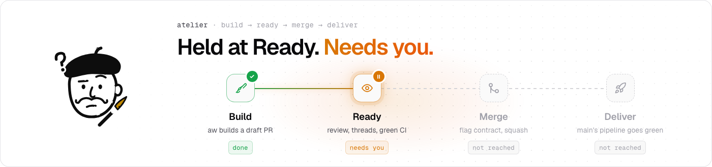

# `/atelier` — from one sentence to a merged, delivered PR


> Describe the change once.
> Atelier builds the PR, gets it green, merges it behind the gates you would check by hand, and watches `main` until the change is delivered.

> [!WARNING]
> **Experimental.**
> The stages, the PR comment, and the merge gate may still change between versions.

![atelier: merges when it can prove it, hands off when it can't. Build & review (aw, review-loop, branch-reviewer, interview, create-pr, ticket: agentic review), Verify (aw-verify, prepare, ci-auto-fix, resolve-conflicts, implement-suggestion: agentic verification), Merge (merge-gate, flag contract, approval wait, prepare --merge), Deliver (main's pipeline, one fix, revert PR), then Roll out with deployment-verify (flag 1 to 100%, auto-rollback). Any stage can stop with one box on the PR, and /atelier <pr> resumes there.](./assets/atelier-flow.png)

**It owns no build, review, or deploy logic of its own.**
Each stage hands the work to a skill that already does it well, and every decision between stages is made by a script, not by the model.

---

## Try it in 30 seconds

```text
/atelier Add a CSV export to the reports page
```

Already have a PR?
Point atelier at it, and it picks up from where the PR is:

```text
/atelier https://github.com/owner/repo/pull/123
```

First time in a repo?
Let atelier check what it can prove there, and fix the gaps with you:

```text
/atelier setup
```

---

## The four stages

| Stage | What runs | It moves on when |
| --- | --- | --- |
| 🖌️ **Build & review** | [`aw`](https://github.com/mthines/agent-skills/blob/main/skills/workflow/autonomous-workflow/aw/SKILL.md) builds a draft PR, with its review, verification, and quality pass | the PR exists, every required companion ran, and the early merge gate passes |
| 👁️ **Verify** | Undrafts the PR, waits for real CI, then [`prepare`](https://github.com/mthines/agent-skills/blob/main/skills/delivery/prepare/SKILL.md) fixes conflicts, CI, and review threads | CI really ran and is green, and the verify report proves every acceptance criterion |
| 🔀 **Merge** | A script gate, then a squash-merge | the gate passes on the live head, and any approval the repo requires has landed |
| 🚀 **Deliver** | Reads `main`'s pipeline for the merge commit | that pipeline is green; a red one gets one fix, then a revert |

A stage that cannot pass stops the run and says why.
Nothing is ever skipped silently.

---

## What you'll see on the PR

Atelier keeps **one sticky comment** on the PR and rewrites it after every stage.

<picture><source media="(prefers-color-scheme: dark)" srcset="./assets/cards/done-hold-pending-pending-dark.png"></picture>

A one-line title names the state ("Verified, merge next", "Held at Verify"), and the card shows the four stages.
While atelier is moving on, or once it is done, that is all you see.
When it needs you, a box appears under the card:

| Box | Means | You do |
| --- | --- | --- |
| 🟡 **Warning** | Held: it is waiting on something, like CI or an approval | the listed thing, then paste the command |
| 🔴 **Caution** | Failed or refused: something must change | fix each numbered item, then paste the command |

Every box ends with the exact command to resume, so you never have to work out where the run stopped:

```text
/atelier https://github.com/owner/repo/pull/123
```

See every state in the [comment gallery](./scripts/fixtures/comments/README.md).

---

## The gates it never skips

- **A user-visible change ships behind a feature flag.**
  The merge gate refuses a UI diff whose PR body has no `deployment-verify:v1` flag contract.
- **A change to a hosted service is verified on its deploy.**
  In a repo whose `release.yml` detects production deploys, every PR carries a contract or a `<!-- deployment-verify:none — <reason> -->` opt-out, and after the pipeline is green Deliver runs `deployment-verify` on a no-flag change: verify, and revert through a PR only when it asks a human to roll back.
- **CI must have actually run.**
  A draft whose checks were all skipped is not green CI.
- **Every acceptance criterion has proof.**
  The PR's verify report must list each criterion with the run that proves it.
- **Reviews happened.**
  A build that skipped its review or verification holds instead of merging.

Only you can waive a gate, with `--accept-skip` or `--accept-gaps`; atelier never waives one itself.

---

## Set up a repo

`/atelier setup` runs preflight, hands each gap to the skill that fixes it, and shows a before/after table.
Every file is optional; each one unlocks a little more.

| File | Unlocks | Written by |
| --- | --- | --- |
| `.agents/aw/environments.yml`, `telemetry.yml` | signed-in UI checks and telemetry proof | `/aw-verify setup` |
| `.agents/aw/release.yml` | flag rollouts, the pipeline Deliver reads, and the deploy detection that turns on the verify | `/deployment-verify setup` |
| `.agents/aw/tracker.yml` | a linked or new ticket for every run | `/ticket setup` |
| `.agents/aw/merge.yml` | waiting for your repo's auto-approval before the merge, and `manual_merge_paths` that atelier never merges | you, by hand |

---

## Flags

| Flag | Effect |
| --- | --- |
| `--ticket <id\|url>` | Link this ticket instead of asking |
| `--unattended` | No human present: a blocking question ends the run instead of waiting |
| `--keep-draft` | Leave the PR a draft; Verify holds when CI skips drafts |
| `--max-wait <minutes>` | The longest one wait for CI or an approval lasts (default 30) |
| `--no-deliver` | Stop at the merge |
| `--accept-gaps` | Accept every preflight gap |
| `--accept-skip <name,…>` | Accept that these companions did not run |

---

## What it never does

- Flip a feature flag or deploy: after the merge, it tells you how to roll a flag out with `/deployment-verify`; it runs `deployment-verify` itself only for a change with no flag.
- Push to the default branch: a fix or a revert goes through its own PR, with the same gates.
- Approve a PR, or merge with `--admin` or `--force`.
- Edit a PR body to make a gate pass.

---

## Learn more

- [`SKILL.md`](./SKILL.md) — the full procedure the agent follows.
- [`rules/`](./rules) — the state comment, the merge gate, Deliver, and telemetry.
- [`references/design.md`](./references/design.md) — why it is built this way.
