<!-- Generated by skills/workflow/atelier/scripts/gallery.mjs — edit a fixture or the script, then rerun it. -->

# atelier comment gallery

The sticky comment `atelier` keeps on a PR, in every state, rendered by [`state.mjs`](../../state.mjs) from the `*.json` state beside it.
Each comment opens with a status card picked from [`assets/cards/`](../../../assets/cards), pre-rendered by [`render-cards.mjs`](../../render-cards.mjs) in a light and a dark version; GitHub shows the one matching your theme.
The layout contract is [`rules/state.md`](../../../rules/state.md).

## Changing a state or the art

1. Edit `<name>.json` here, or [`card.mjs`](../../card.mjs) / [`mascot.mjs`](../../mascot.mjs) for the art.
2. After an art change, re-render the cards: `node skills/workflow/atelier/scripts/render-cards.mjs` (needs Chrome).
3. Rebuild this file: `node skills/workflow/atelier/scripts/gallery.mjs`; L1 `G114` runs its `--self-test`, which fails on a stale README or a missing card.

## States

- [Built](#built)
- [Ready (existing PR, limited preflight)](#ready-existing-pr-limited-preflight)
- [Held at Build](#held-at-build)
- [Build failed, two problems](#build-failed-two-problems)
- [Build refused](#build-refused)
- [Held at Ready](#held-at-ready)
- [Ready failed](#ready-failed)
- [Merge refused](#merge-refused)
- [Merged, delivering](#merged-delivering)
- [Merged and delivered](#merged-and-delivered)
- [Deliver failed and reverted](#deliver-failed-and-reverted)
- [Every card](#every-card)
- [Mascot](#mascot)

## Built

aw opened the draft PR and its companions ran; Ready runs next.

State: [`built.json`](built.json)

> [!NOTE]
> Rendered as GitHub shows it; times read as a fixed date here and as "2 minutes ago" on a PR.

<!-- atelier:v1 -->
<picture><source media="(prefers-color-scheme: dark)" srcset="../../../assets/cards/done-pending-pending-pending-dark.png">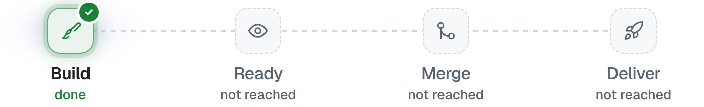</picture>

> [!TIP]
> **Next: Ready** gets the PR green: review, threads, and CI.
>
> Atelier carries on by itself; if this run stopped, re-run:
>
> ```text
> /atelier https://github.com/mthines/reaper-mcp/pull/195
> ```

<sub> Atelier · head <code>8e0b152</code> · updated <relative-time datetime="2026-11-25T13:02:10.000Z">Nov 25, 2026 1:02pm</relative-time></sub>

<details>
<summary>Run details</summary>

| | Stage | Outcome | Head | When | Why |
| :-: | --- | --- | --- | --- | --- |
| ✅ | Build | done | `8e0b152` | <relative-time datetime="2026-11-25T13:02:10.000Z">Nov 25, 2026 1:02pm</relative-time> | aw Full: draft PR, review-loop converged |
| ⚪ | Ready | not reached | | | |
| ⚪ | Merge | not reached | | | |
| ⚪ | Deliver | not reached | | | |

**Preflight:** `ok — 0 gaps`

Re-run `/atelier https://github.com/mthines/reaper-mcp/pull/195` to resume at the first incomplete stage.

</details>

<!-- atelier:v1:state {"v":1,"pr":"https://github.com/mthines/reaper-mcp/pull/195","stages":{"build":{"decision":"proceed","at":"2026-11-25T13:02:10.000Z","sha":"8e0b152270c509ca9634c6cd3363da87f98bd0ad","reason":"aw Full: draft PR, review-loop converged"}},"preflight":"PREFLIGHT: ok — 0 gaps","stage":"build","refusal":null} -->

<details>
<summary>Markdown source</summary>

````markdown
<!-- atelier:v1 -->
<picture><source media="(prefers-color-scheme: dark)" srcset="https://raw.githubusercontent.com/mthines/agent-skills/main/skills/workflow/atelier/assets/cards/done-pending-pending-pending-dark.png"></picture>

> [!TIP]
> **Next: Ready** gets the PR green: review, threads, and CI.
>
> Atelier carries on by itself; if this run stopped, re-run:
>
> ```text
> /atelier https://github.com/mthines/reaper-mcp/pull/195
> ```

<sub> Atelier · head <code>8e0b152</code> · updated <relative-time datetime="2026-11-25T13:02:10.000Z">Nov 25, 2026 1:02pm</relative-time></sub>

<details>
<summary>Run details</summary>

| | Stage | Outcome | Head | When | Why |
| :-: | --- | --- | --- | --- | --- |
| ✅ | Build | done | `8e0b152` | <relative-time datetime="2026-11-25T13:02:10.000Z">Nov 25, 2026 1:02pm</relative-time> | aw Full: draft PR, review-loop converged |
| ⚪ | Ready | not reached | | | |
| ⚪ | Merge | not reached | | | |
| ⚪ | Deliver | not reached | | | |

**Preflight:** `ok — 0 gaps`

Re-run `/atelier https://github.com/mthines/reaper-mcp/pull/195` to resume at the first incomplete stage.

</details>

<!-- atelier:v1:state {"v":1,"pr":"https://github.com/mthines/reaper-mcp/pull/195","stages":{"build":{"decision":"proceed","at":"2026-11-25T13:02:10.000Z","sha":"8e0b152270c509ca9634c6cd3363da87f98bd0ad","reason":"aw Full: draft PR, review-loop converged"}},"preflight":"PREFLIGHT: ok — 0 gaps","stage":"build","refusal":null} -->
````

</details>

## Ready (existing PR, limited preflight)

Build skipped for an existing PR, Ready passed with green CI evidence, and a preflight gap shows as a heads-up.

State: [`existing-pr-ready.json`](existing-pr-ready.json)

> [!NOTE]
> Rendered as GitHub shows it; times read as a fixed date here and as "2 minutes ago" on a PR.

<!-- atelier:v1 -->
<picture><source media="(prefers-color-scheme: dark)" srcset="../../../assets/cards/skipped-done-pending-pending-dark.png">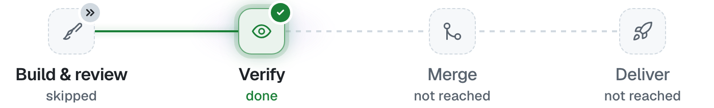</picture>

> [!TIP]
> **Next: Merge** runs the merge gate, then squash-merges.
>
> Atelier carries on by itself; if this run stopped, re-run:
>
> ```text
> /atelier https://github.com/mthines/reaper-mcp/pull/195
> ```

<sub> Atelier · head <code>8e0b152</code> · updated <relative-time datetime="2026-11-25T13:27:43.081Z">Nov 25, 2026 1:27pm</relative-time></sub>

<details>
<summary>Run details</summary>

| | Stage | Outcome | Head | When | Why |
| :-: | --- | --- | --- | --- | --- |
| ⏭️ | Build | skipped | `8e0b152` | <relative-time datetime="2026-11-25T13:27:26.793Z">Nov 25, 2026 1:27pm</relative-time> | existing PR |
| ✅ | Ready | done | `8e0b152` | <relative-time datetime="2026-11-25T13:27:43.081Z">Nov 25, 2026 1:27pm</relative-time> | reviewed (WARN, no findings); mergeable, no open threads; CI green at head |
| ⚪ | Merge | not reached | | | |
| ⚪ | Deliver | not reached | | | |

**CI at `8e0b152`:** 🟢 1 required check ran and passed at 8e0b152 (`test`)
**Preflight:** `limited — 1 gap (flag-provider)`

Re-run `/atelier https://github.com/mthines/reaper-mcp/pull/195` to resume at the first incomplete stage.

</details>

<!-- atelier:v1:state {"v":1,"pr":"https://github.com/mthines/reaper-mcp/pull/195","stages":{"build":{"decision":"skipped","at":"2026-11-25T13:27:26.793Z","sha":"8e0b152270c509ca9634c6cd3363da87f98bd0ad","reason":"existing PR"},"ready":{"decision":"proceed","at":"2026-11-25T13:27:43.081Z","sha":"8e0b152270c509ca9634c6cd3363da87f98bd0ad","reason":"reviewed (WARN, no findings); mergeable, no open threads; CI green at head","ci":{"state":"green","ran":true,"head":"8e0b152270c509ca9634c6cd3363da87f98bd0ad","basis":"required","ran_checks":["test"],"reason":"1 required check ran and passed at 8e0b152"}}},"preflight":"PREFLIGHT: limited — 1 gap (flag-provider)","stage":"ready","refusal":null} -->

<details>
<summary>Markdown source</summary>

````markdown
<!-- atelier:v1 -->
<picture><source media="(prefers-color-scheme: dark)" srcset="https://raw.githubusercontent.com/mthines/agent-skills/main/skills/workflow/atelier/assets/cards/skipped-done-pending-pending-dark.png"></picture>

> [!TIP]
> **Next: Merge** runs the merge gate, then squash-merges.
>
> Atelier carries on by itself; if this run stopped, re-run:
>
> ```text
> /atelier https://github.com/mthines/reaper-mcp/pull/195
> ```

<sub> Atelier · head <code>8e0b152</code> · updated <relative-time datetime="2026-11-25T13:27:43.081Z">Nov 25, 2026 1:27pm</relative-time></sub>

<details>
<summary>Run details</summary>

| | Stage | Outcome | Head | When | Why |
| :-: | --- | --- | --- | --- | --- |
| ⏭️ | Build | skipped | `8e0b152` | <relative-time datetime="2026-11-25T13:27:26.793Z">Nov 25, 2026 1:27pm</relative-time> | existing PR |
| ✅ | Ready | done | `8e0b152` | <relative-time datetime="2026-11-25T13:27:43.081Z">Nov 25, 2026 1:27pm</relative-time> | reviewed (WARN, no findings); mergeable, no open threads; CI green at head |
| ⚪ | Merge | not reached | | | |
| ⚪ | Deliver | not reached | | | |

**CI at `8e0b152`:** 🟢 1 required check ran and passed at 8e0b152 (`test`)
**Preflight:** `limited — 1 gap (flag-provider)`

Re-run `/atelier https://github.com/mthines/reaper-mcp/pull/195` to resume at the first incomplete stage.

</details>

<!-- atelier:v1:state {"v":1,"pr":"https://github.com/mthines/reaper-mcp/pull/195","stages":{"build":{"decision":"skipped","at":"2026-11-25T13:27:26.793Z","sha":"8e0b152270c509ca9634c6cd3363da87f98bd0ad","reason":"existing PR"},"ready":{"decision":"proceed","at":"2026-11-25T13:27:43.081Z","sha":"8e0b152270c509ca9634c6cd3363da87f98bd0ad","reason":"reviewed (WARN, no findings); mergeable, no open threads; CI green at head","ci":{"state":"green","ran":true,"head":"8e0b152270c509ca9634c6cd3363da87f98bd0ad","basis":"required","ran_checks":["test"],"reason":"1 required check ran and passed at 8e0b152"}}},"preflight":"PREFLIGHT: limited — 1 gap (flag-provider)","stage":"ready","refusal":null} -->
````

</details>

## Held at Build

A required companion did not run, so Build holds and names it.

State: [`build-held.json`](build-held.json)

> [!NOTE]
> Rendered as GitHub shows it; times read as a fixed date here and as "2 minutes ago" on a PR.

<!-- atelier:v1 -->
<picture><source media="(prefers-color-scheme: dark)" srcset="../../../assets/cards/hold-pending-pending-pending-dark.png">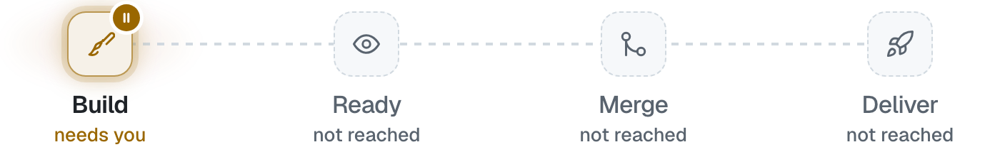</picture>

> [!WARNING]
> **Build held: skipped: review-loop.**
>
> Then re-run:
>
> ```text
> /atelier https://github.com/mthines/reaper-mcp/pull/195
> ```

<sub> Atelier · head <code>8e0b152</code> · updated <relative-time datetime="2026-11-25T13:02:10.000Z">Nov 25, 2026 1:02pm</relative-time></sub>

<details>
<summary>Run details</summary>

| | Stage | Outcome | Head | When | Why |
| :-: | --- | --- | --- | --- | --- |
| ⏸️ | Build | held | `8e0b152` | <relative-time datetime="2026-11-25T13:02:10.000Z">Nov 25, 2026 1:02pm</relative-time> | skipped: review-loop |
| ⚪ | Ready | not reached | | | |
| ⚪ | Merge | not reached | | | |
| ⚪ | Deliver | not reached | | | |

**Preflight:** `ok — 0 gaps`

Re-run `/atelier https://github.com/mthines/reaper-mcp/pull/195` to resume at the first incomplete stage.

</details>

<!-- atelier:v1:state {"v":1,"pr":"https://github.com/mthines/reaper-mcp/pull/195","stages":{"build":{"decision":"hold","at":"2026-11-25T13:02:10.000Z","sha":"8e0b152270c509ca9634c6cd3363da87f98bd0ad","reason":"skipped: review-loop"}},"preflight":"PREFLIGHT: ok — 0 gaps","stage":"build","refusal":null} -->

<details>
<summary>Markdown source</summary>

````markdown
<!-- atelier:v1 -->
<picture><source media="(prefers-color-scheme: dark)" srcset="https://raw.githubusercontent.com/mthines/agent-skills/main/skills/workflow/atelier/assets/cards/hold-pending-pending-pending-dark.png"></picture>

> [!WARNING]
> **Build held: skipped: review-loop.**
>
> Then re-run:
>
> ```text
> /atelier https://github.com/mthines/reaper-mcp/pull/195
> ```

<sub> Atelier · head <code>8e0b152</code> · updated <relative-time datetime="2026-11-25T13:02:10.000Z">Nov 25, 2026 1:02pm</relative-time></sub>

<details>
<summary>Run details</summary>

| | Stage | Outcome | Head | When | Why |
| :-: | --- | --- | --- | --- | --- |
| ⏸️ | Build | held | `8e0b152` | <relative-time datetime="2026-11-25T13:02:10.000Z">Nov 25, 2026 1:02pm</relative-time> | skipped: review-loop |
| ⚪ | Ready | not reached | | | |
| ⚪ | Merge | not reached | | | |
| ⚪ | Deliver | not reached | | | |

**Preflight:** `ok — 0 gaps`

Re-run `/atelier https://github.com/mthines/reaper-mcp/pull/195` to resume at the first incomplete stage.

</details>

<!-- atelier:v1:state {"v":1,"pr":"https://github.com/mthines/reaper-mcp/pull/195","stages":{"build":{"decision":"hold","at":"2026-11-25T13:02:10.000Z","sha":"8e0b152270c509ca9634c6cd3363da87f98bd0ad","reason":"skipped: review-loop"}},"preflight":"PREFLIGHT: ok — 0 gaps","stage":"build","refusal":null} -->
````

</details>

## Build failed, two problems

Two problems stopped Build; each gets its own line, and the limited preflight stays in Run details because it did not cause the stop.

State: [`build-failed.json`](build-failed.json)

> [!NOTE]
> Rendered as GitHub shows it; times read as a fixed date here and as "2 minutes ago" on a PR.

<!-- atelier:v1 -->
<picture><source media="(prefers-color-scheme: dark)" srcset="../../../assets/cards/failed-pending-pending-pending-dark.png">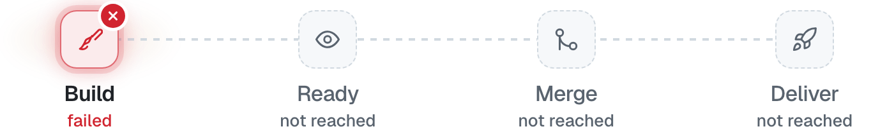</picture>

> [!CAUTION]
> **Build failed: fix 2 things, then re-run.**
>
> 1. merge gate could not run: gh GraphQL is blocked in this session (HTTP 403).
> 2. review-loop hit its cap, so the last fixes are unreviewed.
>
> ```text
> /atelier https://github.com/mthines/reaper-mcp/pull/195
> ```

<sub> Atelier · head <code>8e0b152</code> · updated <relative-time datetime="2026-11-25T13:02:10.000Z">Nov 25, 2026 1:02pm</relative-time></sub>

<details>
<summary>Run details</summary>

| | Stage | Outcome | Head | When | Why |
| :-: | --- | --- | --- | --- | --- |
| ❌ | Build | failed | `8e0b152` | <relative-time datetime="2026-11-25T13:02:10.000Z">Nov 25, 2026 1:02pm</relative-time> | merge gate could not run: gh GraphQL is blocked in this session (HTTP 403); review-loop hit its cap, so the last fixes are unreviewed |
| ⚪ | Ready | not reached | | | |
| ⚪ | Merge | not reached | | | |
| ⚪ | Deliver | not reached | | | |

**Preflight:** `limited — 1 gap (flag-provider)`

Re-run `/atelier https://github.com/mthines/reaper-mcp/pull/195` to resume at the first incomplete stage.

</details>

<!-- atelier:v1:state {"v":1,"pr":"https://github.com/mthines/reaper-mcp/pull/195","stages":{"build":{"decision":"failed","at":"2026-11-25T13:02:10.000Z","sha":"8e0b152270c509ca9634c6cd3363da87f98bd0ad","reason":"merge gate could not run: gh GraphQL is blocked in this session (HTTP 403); review-loop hit its cap, so the last fixes are unreviewed"}},"preflight":"PREFLIGHT: limited — 1 gap (flag-provider)","stage":"build","refusal":null} -->

<details>
<summary>Markdown source</summary>

````markdown
<!-- atelier:v1 -->
<picture><source media="(prefers-color-scheme: dark)" srcset="https://raw.githubusercontent.com/mthines/agent-skills/main/skills/workflow/atelier/assets/cards/failed-pending-pending-pending-dark.png"></picture>

> [!CAUTION]
> **Build failed: fix 2 things, then re-run.**
>
> 1. merge gate could not run: gh GraphQL is blocked in this session (HTTP 403).
> 2. review-loop hit its cap, so the last fixes are unreviewed.
>
> ```text
> /atelier https://github.com/mthines/reaper-mcp/pull/195
> ```

<sub> Atelier · head <code>8e0b152</code> · updated <relative-time datetime="2026-11-25T13:02:10.000Z">Nov 25, 2026 1:02pm</relative-time></sub>

<details>
<summary>Run details</summary>

| | Stage | Outcome | Head | When | Why |
| :-: | --- | --- | --- | --- | --- |
| ❌ | Build | failed | `8e0b152` | <relative-time datetime="2026-11-25T13:02:10.000Z">Nov 25, 2026 1:02pm</relative-time> | merge gate could not run: gh GraphQL is blocked in this session (HTTP 403); review-loop hit its cap, so the last fixes are unreviewed |
| ⚪ | Ready | not reached | | | |
| ⚪ | Merge | not reached | | | |
| ⚪ | Deliver | not reached | | | |

**Preflight:** `limited — 1 gap (flag-provider)`

Re-run `/atelier https://github.com/mthines/reaper-mcp/pull/195` to resume at the first incomplete stage.

</details>

<!-- atelier:v1:state {"v":1,"pr":"https://github.com/mthines/reaper-mcp/pull/195","stages":{"build":{"decision":"failed","at":"2026-11-25T13:02:10.000Z","sha":"8e0b152270c509ca9634c6cd3363da87f98bd0ad","reason":"merge gate could not run: gh GraphQL is blocked in this session (HTTP 403); review-loop hit its cap, so the last fixes are unreviewed"}},"preflight":"PREFLIGHT: limited — 1 gap (flag-provider)","stage":"build","refusal":null} -->
````

</details>

## Build refused

The early merge gate refused twice, so Build records `refuse` and names the gate's line.

State: [`build-refused.json`](build-refused.json)

> [!NOTE]
> Rendered as GitHub shows it; times read as a fixed date here and as "2 minutes ago" on a PR.

<!-- atelier:v1 -->
<picture><source media="(prefers-color-scheme: dark)" srcset="../../../assets/cards/refuse-pending-pending-pending-dark.png">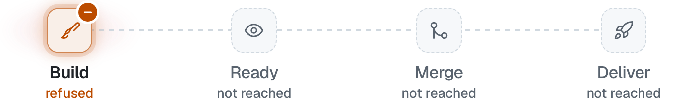</picture>

> [!CAUTION]
> **Build refused: MERGE_GATE: refuse — user-visible diff, no flag contract (after one Build retry).**
>
> Then re-run:
>
> ```text
> /atelier https://github.com/mthines/reaper-mcp/pull/195
> ```

<sub> Atelier · head <code>8e0b152</code> · updated <relative-time datetime="2026-11-25T13:12:00.000Z">Nov 25, 2026 1:12pm</relative-time></sub>

<details>
<summary>Run details</summary>

| | Stage | Outcome | Head | When | Why |
| :-: | --- | --- | --- | --- | --- |
| ⛔ | Build | refused | `8e0b152` | <relative-time datetime="2026-11-25T13:12:00.000Z">Nov 25, 2026 1:12pm</relative-time> | MERGE_GATE: refuse — user-visible diff, no flag contract (after one Build retry) |
| ⚪ | Ready | not reached | | | |
| ⚪ | Merge | not reached | | | |
| ⚪ | Deliver | not reached | | | |

**Preflight:** `ok — 0 gaps`

Re-run `/atelier https://github.com/mthines/reaper-mcp/pull/195` to resume at the first incomplete stage.

</details>

<!-- atelier:v1:state {"v":1,"pr":"https://github.com/mthines/reaper-mcp/pull/195","stages":{"build":{"decision":"refuse","at":"2026-11-25T13:12:00.000Z","sha":"8e0b152270c509ca9634c6cd3363da87f98bd0ad","reason":"MERGE_GATE: refuse — user-visible diff, no flag contract (after one Build retry)"}},"preflight":"PREFLIGHT: ok — 0 gaps","stage":"build","refusal":"MERGE_GATE: refuse — user-visible diff, no flag contract (after one Build retry)"} -->

<details>
<summary>Markdown source</summary>

````markdown
<!-- atelier:v1 -->
<picture><source media="(prefers-color-scheme: dark)" srcset="https://raw.githubusercontent.com/mthines/agent-skills/main/skills/workflow/atelier/assets/cards/refuse-pending-pending-pending-dark.png"></picture>

> [!CAUTION]
> **Build refused: MERGE_GATE: refuse — user-visible diff, no flag contract (after one Build retry).**
>
> Then re-run:
>
> ```text
> /atelier https://github.com/mthines/reaper-mcp/pull/195
> ```

<sub> Atelier · head <code>8e0b152</code> · updated <relative-time datetime="2026-11-25T13:12:00.000Z">Nov 25, 2026 1:12pm</relative-time></sub>

<details>
<summary>Run details</summary>

| | Stage | Outcome | Head | When | Why |
| :-: | --- | --- | --- | --- | --- |
| ⛔ | Build | refused | `8e0b152` | <relative-time datetime="2026-11-25T13:12:00.000Z">Nov 25, 2026 1:12pm</relative-time> | MERGE_GATE: refuse — user-visible diff, no flag contract (after one Build retry) |
| ⚪ | Ready | not reached | | | |
| ⚪ | Merge | not reached | | | |
| ⚪ | Deliver | not reached | | | |

**Preflight:** `ok — 0 gaps`

Re-run `/atelier https://github.com/mthines/reaper-mcp/pull/195` to resume at the first incomplete stage.

</details>

<!-- atelier:v1:state {"v":1,"pr":"https://github.com/mthines/reaper-mcp/pull/195","stages":{"build":{"decision":"refuse","at":"2026-11-25T13:12:00.000Z","sha":"8e0b152270c509ca9634c6cd3363da87f98bd0ad","reason":"MERGE_GATE: refuse — user-visible diff, no flag contract (after one Build retry)"}},"preflight":"PREFLIGHT: ok — 0 gaps","stage":"build","refusal":"MERGE_GATE: refuse — user-visible diff, no flag contract (after one Build retry)"} -->
````

</details>

## Held at Ready

CI never ran on the draft, so Ready holds instead of passing on skipped checks.

State: [`ready-held.json`](ready-held.json)

> [!NOTE]
> Rendered as GitHub shows it; times read as a fixed date here and as "2 minutes ago" on a PR.

<!-- atelier:v1 -->
<picture><source media="(prefers-color-scheme: dark)" srcset="../../../assets/cards/done-hold-pending-pending-dark.png">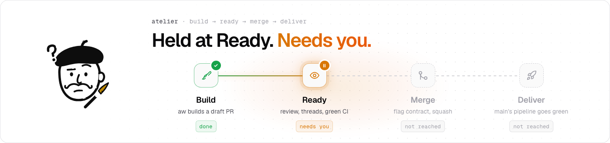</picture>

> [!WARNING]
> **Ready held: CI not run: draft — every required check skipped (4).**
>
> Then re-run:
>
> ```text
> /atelier https://github.com/mthines/reaper-mcp/pull/195
> ```

<sub> Atelier · head <code>8e0b152</code> · updated <relative-time datetime="2026-11-25T13:20:00.000Z">Nov 25, 2026 1:20pm</relative-time></sub>

<details>
<summary>Run details</summary>

| | Stage | Outcome | Head | When | Why |
| :-: | --- | --- | --- | --- | --- |
| ✅ | Build | done | `8e0b152` | <relative-time datetime="2026-11-25T13:02:10.000Z">Nov 25, 2026 1:02pm</relative-time> | aw Full: draft PR, review-loop converged |
| ⏸️ | Ready | held | `8e0b152` | <relative-time datetime="2026-11-25T13:20:00.000Z">Nov 25, 2026 1:20pm</relative-time> | CI not run: draft — every required check skipped (4) |
| ⚪ | Merge | not reached | | | |
| ⚪ | Deliver | not reached | | | |

**Preflight:** `ok — 0 gaps`

Re-run `/atelier https://github.com/mthines/reaper-mcp/pull/195` to resume at the first incomplete stage.

</details>

<!-- atelier:v1:state {"v":1,"pr":"https://github.com/mthines/reaper-mcp/pull/195","stages":{"build":{"decision":"proceed","at":"2026-11-25T13:02:10.000Z","sha":"8e0b152270c509ca9634c6cd3363da87f98bd0ad","reason":"aw Full: draft PR, review-loop converged"},"ready":{"decision":"hold","at":"2026-11-25T13:20:00.000Z","sha":"8e0b152270c509ca9634c6cd3363da87f98bd0ad","reason":"CI not run: draft — every required check skipped (4)"}},"preflight":"PREFLIGHT: ok — 0 gaps","stage":"ready","refusal":null} -->

<details>
<summary>Markdown source</summary>

````markdown
<!-- atelier:v1 -->
<picture><source media="(prefers-color-scheme: dark)" srcset="https://raw.githubusercontent.com/mthines/agent-skills/main/skills/workflow/atelier/assets/cards/done-hold-pending-pending-dark.png"></picture>

> [!WARNING]
> **Ready held: CI not run: draft — every required check skipped (4).**
>
> Then re-run:
>
> ```text
> /atelier https://github.com/mthines/reaper-mcp/pull/195
> ```

<sub> Atelier · head <code>8e0b152</code> · updated <relative-time datetime="2026-11-25T13:20:00.000Z">Nov 25, 2026 1:20pm</relative-time></sub>

<details>
<summary>Run details</summary>

| | Stage | Outcome | Head | When | Why |
| :-: | --- | --- | --- | --- | --- |
| ✅ | Build | done | `8e0b152` | <relative-time datetime="2026-11-25T13:02:10.000Z">Nov 25, 2026 1:02pm</relative-time> | aw Full: draft PR, review-loop converged |
| ⏸️ | Ready | held | `8e0b152` | <relative-time datetime="2026-11-25T13:20:00.000Z">Nov 25, 2026 1:20pm</relative-time> | CI not run: draft — every required check skipped (4) |
| ⚪ | Merge | not reached | | | |
| ⚪ | Deliver | not reached | | | |

**Preflight:** `ok — 0 gaps`

Re-run `/atelier https://github.com/mthines/reaper-mcp/pull/195` to resume at the first incomplete stage.

</details>

<!-- atelier:v1:state {"v":1,"pr":"https://github.com/mthines/reaper-mcp/pull/195","stages":{"build":{"decision":"proceed","at":"2026-11-25T13:02:10.000Z","sha":"8e0b152270c509ca9634c6cd3363da87f98bd0ad","reason":"aw Full: draft PR, review-loop converged"},"ready":{"decision":"hold","at":"2026-11-25T13:20:00.000Z","sha":"8e0b152270c509ca9634c6cd3363da87f98bd0ad","reason":"CI not run: draft — every required check skipped (4)"}},"preflight":"PREFLIGHT: ok — 0 gaps","stage":"ready","refusal":null} -->
````

</details>

## Ready failed

CI stayed red after the one fix attempt.

State: [`ready-failed.json`](ready-failed.json)

> [!NOTE]
> Rendered as GitHub shows it; times read as a fixed date here and as "2 minutes ago" on a PR.

<!-- atelier:v1 -->
<picture><source media="(prefers-color-scheme: dark)" srcset="../../../assets/cards/done-failed-pending-pending-dark.png">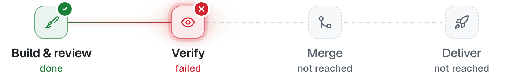</picture>

> [!CAUTION]
> **Ready failed: CI red at 8e0b152: test failed after one fix attempt.**
>
> Then re-run:
>
> ```text
> /atelier https://github.com/mthines/reaper-mcp/pull/195
> ```

<sub> Atelier · head <code>8e0b152</code> · updated <relative-time datetime="2026-11-25T13:20:00.000Z">Nov 25, 2026 1:20pm</relative-time></sub>

<details>
<summary>Run details</summary>

| | Stage | Outcome | Head | When | Why |
| :-: | --- | --- | --- | --- | --- |
| ✅ | Build | done | `8e0b152` | <relative-time datetime="2026-11-25T13:02:10.000Z">Nov 25, 2026 1:02pm</relative-time> | aw Full: draft PR, review-loop converged |
| ❌ | Ready | failed | `8e0b152` | <relative-time datetime="2026-11-25T13:20:00.000Z">Nov 25, 2026 1:20pm</relative-time> | CI red at 8e0b152: test failed after one fix attempt |
| ⚪ | Merge | not reached | | | |
| ⚪ | Deliver | not reached | | | |

**Preflight:** `ok — 0 gaps`

Re-run `/atelier https://github.com/mthines/reaper-mcp/pull/195` to resume at the first incomplete stage.

</details>

<!-- atelier:v1:state {"v":1,"pr":"https://github.com/mthines/reaper-mcp/pull/195","stages":{"build":{"decision":"proceed","at":"2026-11-25T13:02:10.000Z","sha":"8e0b152270c509ca9634c6cd3363da87f98bd0ad","reason":"aw Full: draft PR, review-loop converged"},"ready":{"decision":"failed","at":"2026-11-25T13:20:00.000Z","sha":"8e0b152270c509ca9634c6cd3363da87f98bd0ad","reason":"CI red at 8e0b152: test failed after one fix attempt"}},"preflight":"PREFLIGHT: ok — 0 gaps","stage":"ready","refusal":null} -->

<details>
<summary>Markdown source</summary>

````markdown
<!-- atelier:v1 -->
<picture><source media="(prefers-color-scheme: dark)" srcset="https://raw.githubusercontent.com/mthines/agent-skills/main/skills/workflow/atelier/assets/cards/done-failed-pending-pending-dark.png"></picture>

> [!CAUTION]
> **Ready failed: CI red at 8e0b152: test failed after one fix attempt.**
>
> Then re-run:
>
> ```text
> /atelier https://github.com/mthines/reaper-mcp/pull/195
> ```

<sub> Atelier · head <code>8e0b152</code> · updated <relative-time datetime="2026-11-25T13:20:00.000Z">Nov 25, 2026 1:20pm</relative-time></sub>

<details>
<summary>Run details</summary>

| | Stage | Outcome | Head | When | Why |
| :-: | --- | --- | --- | --- | --- |
| ✅ | Build | done | `8e0b152` | <relative-time datetime="2026-11-25T13:02:10.000Z">Nov 25, 2026 1:02pm</relative-time> | aw Full: draft PR, review-loop converged |
| ❌ | Ready | failed | `8e0b152` | <relative-time datetime="2026-11-25T13:20:00.000Z">Nov 25, 2026 1:20pm</relative-time> | CI red at 8e0b152: test failed after one fix attempt |
| ⚪ | Merge | not reached | | | |
| ⚪ | Deliver | not reached | | | |

**Preflight:** `ok — 0 gaps`

Re-run `/atelier https://github.com/mthines/reaper-mcp/pull/195` to resume at the first incomplete stage.

</details>

<!-- atelier:v1:state {"v":1,"pr":"https://github.com/mthines/reaper-mcp/pull/195","stages":{"build":{"decision":"proceed","at":"2026-11-25T13:02:10.000Z","sha":"8e0b152270c509ca9634c6cd3363da87f98bd0ad","reason":"aw Full: draft PR, review-loop converged"},"ready":{"decision":"failed","at":"2026-11-25T13:20:00.000Z","sha":"8e0b152270c509ca9634c6cd3363da87f98bd0ad","reason":"CI red at 8e0b152: test failed after one fix attempt"}},"preflight":"PREFLIGHT: ok — 0 gaps","stage":"ready","refusal":null} -->
````

</details>

## Merge refused

The merge gate refused a user-visible diff without a flag contract.

State: [`merge-refused.json`](merge-refused.json)

> [!NOTE]
> Rendered as GitHub shows it; times read as a fixed date here and as "2 minutes ago" on a PR.

<!-- atelier:v1 -->
<picture><source media="(prefers-color-scheme: dark)" srcset="../../../assets/cards/done-done-refuse-pending-dark.png"></picture>

> [!CAUTION]
> **Merge refused: user-visible diff without a flag contract in the PR body.**
>
> Then re-run:
>
> ```text
> /atelier https://github.com/mthines/reaper-mcp/pull/195
> ```

<sub> Atelier · head <code>8e0b152</code> · updated <relative-time datetime="2026-11-25T13:30:00.000Z">Nov 25, 2026 1:30pm</relative-time></sub>

<details>
<summary>Run details</summary>

| | Stage | Outcome | Head | When | Why |
| :-: | --- | --- | --- | --- | --- |
| ✅ | Build | done | `8e0b152` | <relative-time datetime="2026-11-25T13:02:10.000Z">Nov 25, 2026 1:02pm</relative-time> | aw Full: draft PR, review-loop converged |
| ✅ | Ready | done | `8e0b152` | <relative-time datetime="2026-11-25T13:27:43.081Z">Nov 25, 2026 1:27pm</relative-time> | reviewed (WARN, no findings); mergeable, no open threads; CI green at head |
| ⛔ | Merge | refused | `8e0b152` | <relative-time datetime="2026-11-25T13:30:00.000Z">Nov 25, 2026 1:30pm</relative-time> | user-visible diff without a flag contract in the PR body |
| ⚪ | Deliver | not reached | | | |

**CI at `8e0b152`:** 🟢 1 required check ran and passed at 8e0b152 (`test`)
**Preflight:** `ok — 0 gaps`

Re-run `/atelier https://github.com/mthines/reaper-mcp/pull/195` to resume at the first incomplete stage.

</details>

<!-- atelier:v1:state {"v":1,"pr":"https://github.com/mthines/reaper-mcp/pull/195","stages":{"build":{"decision":"proceed","at":"2026-11-25T13:02:10.000Z","sha":"8e0b152270c509ca9634c6cd3363da87f98bd0ad","reason":"aw Full: draft PR, review-loop converged"},"ready":{"decision":"proceed","at":"2026-11-25T13:27:43.081Z","sha":"8e0b152270c509ca9634c6cd3363da87f98bd0ad","reason":"reviewed (WARN, no findings); mergeable, no open threads; CI green at head","ci":{"state":"green","ran":true,"head":"8e0b152270c509ca9634c6cd3363da87f98bd0ad","basis":"required","ran_checks":["test"],"reason":"1 required check ran and passed at 8e0b152"}},"merge":{"decision":"refuse","at":"2026-11-25T13:30:00.000Z","sha":"8e0b152270c509ca9634c6cd3363da87f98bd0ad","reason":"user-visible diff without a flag contract in the PR body"}},"preflight":"PREFLIGHT: ok — 0 gaps","stage":"merge","refusal":"user-visible diff without a flag contract in the PR body"} -->

<details>
<summary>Markdown source</summary>

````markdown
<!-- atelier:v1 -->
<picture><source media="(prefers-color-scheme: dark)" srcset="https://raw.githubusercontent.com/mthines/agent-skills/main/skills/workflow/atelier/assets/cards/done-done-refuse-pending-dark.png"></picture>

> [!CAUTION]
> **Merge refused: user-visible diff without a flag contract in the PR body.**
>
> Then re-run:
>
> ```text
> /atelier https://github.com/mthines/reaper-mcp/pull/195
> ```

<sub> Atelier · head <code>8e0b152</code> · updated <relative-time datetime="2026-11-25T13:30:00.000Z">Nov 25, 2026 1:30pm</relative-time></sub>

<details>
<summary>Run details</summary>

| | Stage | Outcome | Head | When | Why |
| :-: | --- | --- | --- | --- | --- |
| ✅ | Build | done | `8e0b152` | <relative-time datetime="2026-11-25T13:02:10.000Z">Nov 25, 2026 1:02pm</relative-time> | aw Full: draft PR, review-loop converged |
| ✅ | Ready | done | `8e0b152` | <relative-time datetime="2026-11-25T13:27:43.081Z">Nov 25, 2026 1:27pm</relative-time> | reviewed (WARN, no findings); mergeable, no open threads; CI green at head |
| ⛔ | Merge | refused | `8e0b152` | <relative-time datetime="2026-11-25T13:30:00.000Z">Nov 25, 2026 1:30pm</relative-time> | user-visible diff without a flag contract in the PR body |
| ⚪ | Deliver | not reached | | | |

**CI at `8e0b152`:** 🟢 1 required check ran and passed at 8e0b152 (`test`)
**Preflight:** `ok — 0 gaps`

Re-run `/atelier https://github.com/mthines/reaper-mcp/pull/195` to resume at the first incomplete stage.

</details>

<!-- atelier:v1:state {"v":1,"pr":"https://github.com/mthines/reaper-mcp/pull/195","stages":{"build":{"decision":"proceed","at":"2026-11-25T13:02:10.000Z","sha":"8e0b152270c509ca9634c6cd3363da87f98bd0ad","reason":"aw Full: draft PR, review-loop converged"},"ready":{"decision":"proceed","at":"2026-11-25T13:27:43.081Z","sha":"8e0b152270c509ca9634c6cd3363da87f98bd0ad","reason":"reviewed (WARN, no findings); mergeable, no open threads; CI green at head","ci":{"state":"green","ran":true,"head":"8e0b152270c509ca9634c6cd3363da87f98bd0ad","basis":"required","ran_checks":["test"],"reason":"1 required check ran and passed at 8e0b152"}},"merge":{"decision":"refuse","at":"2026-11-25T13:30:00.000Z","sha":"8e0b152270c509ca9634c6cd3363da87f98bd0ad","reason":"user-visible diff without a flag contract in the PR body"}},"preflight":"PREFLIGHT: ok — 0 gaps","stage":"merge","refusal":"user-visible diff without a flag contract in the PR body"} -->
````

</details>

## Merged, delivering

Squash-merged; Deliver is reading `main`'s pipeline for the merge commit.

State: [`merged.json`](merged.json)

> [!NOTE]
> Rendered as GitHub shows it; times read as a fixed date here and as "2 minutes ago" on a PR.

<!-- atelier:v1 -->
<picture><source media="(prefers-color-scheme: dark)" srcset="../../../assets/cards/done-done-done-pending-dark.png">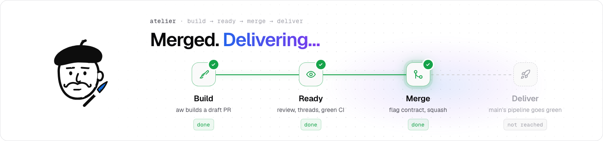</picture>

> [!TIP]
> **Next: Deliver** checks `main`'s pipeline for the merge commit.
>
> Atelier carries on by itself; if this run stopped, re-run:
>
> ```text
> /atelier https://github.com/mthines/reaper-mcp/pull/195
> ```

<sub> Atelier · head <code>8e0b152</code> · updated <relative-time datetime="2026-11-25T13:31:05.000Z">Nov 25, 2026 1:31pm</relative-time></sub>

<details>
<summary>Run details</summary>

| | Stage | Outcome | Head | When | Why |
| :-: | --- | --- | --- | --- | --- |
| ✅ | Build | done | `8e0b152` | <relative-time datetime="2026-11-25T13:02:10.000Z">Nov 25, 2026 1:02pm</relative-time> | aw Full: draft PR, review-loop converged |
| ✅ | Ready | done | `8e0b152` | <relative-time datetime="2026-11-25T13:27:43.081Z">Nov 25, 2026 1:27pm</relative-time> | reviewed (WARN, no findings); mergeable, no open threads; CI green at head |
| ✅ | Merge | done | `8e0b152` | <relative-time datetime="2026-11-25T13:31:05.000Z">Nov 25, 2026 1:31pm</relative-time> | squash-merged as 4f1c2d9; no user-visible diff |
| ⚪ | Deliver | not reached | | | |

**CI at `8e0b152`:** 🟢 1 required check ran and passed at 8e0b152 (`test`)
**Preflight:** `ok — 0 gaps`

Re-run `/atelier https://github.com/mthines/reaper-mcp/pull/195` to resume at the first incomplete stage.

</details>

<!-- atelier:v1:state {"v":1,"pr":"https://github.com/mthines/reaper-mcp/pull/195","stages":{"build":{"decision":"proceed","at":"2026-11-25T13:02:10.000Z","sha":"8e0b152270c509ca9634c6cd3363da87f98bd0ad","reason":"aw Full: draft PR, review-loop converged"},"ready":{"decision":"proceed","at":"2026-11-25T13:27:43.081Z","sha":"8e0b152270c509ca9634c6cd3363da87f98bd0ad","reason":"reviewed (WARN, no findings); mergeable, no open threads; CI green at head","ci":{"state":"green","ran":true,"head":"8e0b152270c509ca9634c6cd3363da87f98bd0ad","basis":"required","ran_checks":["test"],"reason":"1 required check ran and passed at 8e0b152"}},"merge":{"decision":"proceed","at":"2026-11-25T13:31:05.000Z","sha":"8e0b152270c509ca9634c6cd3363da87f98bd0ad","reason":"squash-merged as 4f1c2d9; no user-visible diff"}},"preflight":"PREFLIGHT: ok — 0 gaps","stage":"merge","refusal":null} -->

<details>
<summary>Markdown source</summary>

````markdown
<!-- atelier:v1 -->
<picture><source media="(prefers-color-scheme: dark)" srcset="https://raw.githubusercontent.com/mthines/agent-skills/main/skills/workflow/atelier/assets/cards/done-done-done-pending-dark.png"></picture>

> [!TIP]
> **Next: Deliver** checks `main`'s pipeline for the merge commit.
>
> Atelier carries on by itself; if this run stopped, re-run:
>
> ```text
> /atelier https://github.com/mthines/reaper-mcp/pull/195
> ```

<sub> Atelier · head <code>8e0b152</code> · updated <relative-time datetime="2026-11-25T13:31:05.000Z">Nov 25, 2026 1:31pm</relative-time></sub>

<details>
<summary>Run details</summary>

| | Stage | Outcome | Head | When | Why |
| :-: | --- | --- | --- | --- | --- |
| ✅ | Build | done | `8e0b152` | <relative-time datetime="2026-11-25T13:02:10.000Z">Nov 25, 2026 1:02pm</relative-time> | aw Full: draft PR, review-loop converged |
| ✅ | Ready | done | `8e0b152` | <relative-time datetime="2026-11-25T13:27:43.081Z">Nov 25, 2026 1:27pm</relative-time> | reviewed (WARN, no findings); mergeable, no open threads; CI green at head |
| ✅ | Merge | done | `8e0b152` | <relative-time datetime="2026-11-25T13:31:05.000Z">Nov 25, 2026 1:31pm</relative-time> | squash-merged as 4f1c2d9; no user-visible diff |
| ⚪ | Deliver | not reached | | | |

**CI at `8e0b152`:** 🟢 1 required check ran and passed at 8e0b152 (`test`)
**Preflight:** `ok — 0 gaps`

Re-run `/atelier https://github.com/mthines/reaper-mcp/pull/195` to resume at the first incomplete stage.

</details>

<!-- atelier:v1:state {"v":1,"pr":"https://github.com/mthines/reaper-mcp/pull/195","stages":{"build":{"decision":"proceed","at":"2026-11-25T13:02:10.000Z","sha":"8e0b152270c509ca9634c6cd3363da87f98bd0ad","reason":"aw Full: draft PR, review-loop converged"},"ready":{"decision":"proceed","at":"2026-11-25T13:27:43.081Z","sha":"8e0b152270c509ca9634c6cd3363da87f98bd0ad","reason":"reviewed (WARN, no findings); mergeable, no open threads; CI green at head","ci":{"state":"green","ran":true,"head":"8e0b152270c509ca9634c6cd3363da87f98bd0ad","basis":"required","ran_checks":["test"],"reason":"1 required check ran and passed at 8e0b152"}},"merge":{"decision":"proceed","at":"2026-11-25T13:31:05.000Z","sha":"8e0b152270c509ca9634c6cd3363da87f98bd0ad","reason":"squash-merged as 4f1c2d9; no user-visible diff"}},"preflight":"PREFLIGHT: ok — 0 gaps","stage":"merge","refusal":null} -->
````

</details>

## Merged and delivered

`main` went green for the merge commit.

State: [`delivered.json`](delivered.json)

> [!NOTE]
> Rendered as GitHub shows it; times read as a fixed date here and as "2 minutes ago" on a PR.

<!-- atelier:v1 -->
<picture><source media="(prefers-color-scheme: dark)" srcset="../../../assets/cards/done-done-done-done-dark.png"></picture>

> [!TIP]
> **Done: merged, and `main`'s pipeline is green for the merge commit.**

<sub> Atelier · head <code>4f1c2d9</code> · updated <relative-time datetime="2026-11-25T13:44:12.000Z">Nov 25, 2026 1:44pm</relative-time></sub>

<details>
<summary>Run details</summary>

| | Stage | Outcome | Head | When | Why |
| :-: | --- | --- | --- | --- | --- |
| ✅ | Build | done | `8e0b152` | <relative-time datetime="2026-11-25T13:02:10.000Z">Nov 25, 2026 1:02pm</relative-time> | aw Full: draft PR, review-loop converged |
| ✅ | Ready | done | `8e0b152` | <relative-time datetime="2026-11-25T13:27:43.081Z">Nov 25, 2026 1:27pm</relative-time> | reviewed (WARN, no findings); mergeable, no open threads; CI green at head |
| ✅ | Merge | done | `8e0b152` | <relative-time datetime="2026-11-25T13:31:05.000Z">Nov 25, 2026 1:31pm</relative-time> | squash-merged as 4f1c2d9; no user-visible diff |
| ✅ | Deliver | done | `4f1c2d9` | <relative-time datetime="2026-11-25T13:44:12.000Z">Nov 25, 2026 1:44pm</relative-time> | main green for 4f1c2d9 |

**CI at `8e0b152`:** 🟢 1 required check ran and passed at 8e0b152 (`test`)
**Preflight:** `ok — 0 gaps`

Re-run `/atelier https://github.com/mthines/reaper-mcp/pull/195` to resume at the first incomplete stage.

</details>

<!-- atelier:v1:state {"v":1,"pr":"https://github.com/mthines/reaper-mcp/pull/195","stages":{"build":{"decision":"proceed","at":"2026-11-25T13:02:10.000Z","sha":"8e0b152270c509ca9634c6cd3363da87f98bd0ad","reason":"aw Full: draft PR, review-loop converged"},"ready":{"decision":"proceed","at":"2026-11-25T13:27:43.081Z","sha":"8e0b152270c509ca9634c6cd3363da87f98bd0ad","reason":"reviewed (WARN, no findings); mergeable, no open threads; CI green at head","ci":{"state":"green","ran":true,"head":"8e0b152270c509ca9634c6cd3363da87f98bd0ad","basis":"required","ran_checks":["test"],"reason":"1 required check ran and passed at 8e0b152"}},"merge":{"decision":"proceed","at":"2026-11-25T13:31:05.000Z","sha":"8e0b152270c509ca9634c6cd3363da87f98bd0ad","reason":"squash-merged as 4f1c2d9; no user-visible diff"},"deliver":{"decision":"proceed","at":"2026-11-25T13:44:12.000Z","sha":"4f1c2d9a0b","reason":"main green for 4f1c2d9"}},"preflight":"PREFLIGHT: ok — 0 gaps","stage":"deliver","refusal":null} -->

<details>
<summary>Markdown source</summary>

````markdown
<!-- atelier:v1 -->
<picture><source media="(prefers-color-scheme: dark)" srcset="https://raw.githubusercontent.com/mthines/agent-skills/main/skills/workflow/atelier/assets/cards/done-done-done-done-dark.png"></picture>

> [!TIP]
> **Done: merged, and `main`'s pipeline is green for the merge commit.**

<sub> Atelier · head <code>4f1c2d9</code> · updated <relative-time datetime="2026-11-25T13:44:12.000Z">Nov 25, 2026 1:44pm</relative-time></sub>

<details>
<summary>Run details</summary>

| | Stage | Outcome | Head | When | Why |
| :-: | --- | --- | --- | --- | --- |
| ✅ | Build | done | `8e0b152` | <relative-time datetime="2026-11-25T13:02:10.000Z">Nov 25, 2026 1:02pm</relative-time> | aw Full: draft PR, review-loop converged |
| ✅ | Ready | done | `8e0b152` | <relative-time datetime="2026-11-25T13:27:43.081Z">Nov 25, 2026 1:27pm</relative-time> | reviewed (WARN, no findings); mergeable, no open threads; CI green at head |
| ✅ | Merge | done | `8e0b152` | <relative-time datetime="2026-11-25T13:31:05.000Z">Nov 25, 2026 1:31pm</relative-time> | squash-merged as 4f1c2d9; no user-visible diff |
| ✅ | Deliver | done | `4f1c2d9` | <relative-time datetime="2026-11-25T13:44:12.000Z">Nov 25, 2026 1:44pm</relative-time> | main green for 4f1c2d9 |

**CI at `8e0b152`:** 🟢 1 required check ran and passed at 8e0b152 (`test`)
**Preflight:** `ok — 0 gaps`

Re-run `/atelier https://github.com/mthines/reaper-mcp/pull/195` to resume at the first incomplete stage.

</details>

<!-- atelier:v1:state {"v":1,"pr":"https://github.com/mthines/reaper-mcp/pull/195","stages":{"build":{"decision":"proceed","at":"2026-11-25T13:02:10.000Z","sha":"8e0b152270c509ca9634c6cd3363da87f98bd0ad","reason":"aw Full: draft PR, review-loop converged"},"ready":{"decision":"proceed","at":"2026-11-25T13:27:43.081Z","sha":"8e0b152270c509ca9634c6cd3363da87f98bd0ad","reason":"reviewed (WARN, no findings); mergeable, no open threads; CI green at head","ci":{"state":"green","ran":true,"head":"8e0b152270c509ca9634c6cd3363da87f98bd0ad","basis":"required","ran_checks":["test"],"reason":"1 required check ran and passed at 8e0b152"}},"merge":{"decision":"proceed","at":"2026-11-25T13:31:05.000Z","sha":"8e0b152270c509ca9634c6cd3363da87f98bd0ad","reason":"squash-merged as 4f1c2d9; no user-visible diff"},"deliver":{"decision":"proceed","at":"2026-11-25T13:44:12.000Z","sha":"4f1c2d9a0b","reason":"main green for 4f1c2d9"}},"preflight":"PREFLIGHT: ok — 0 gaps","stage":"deliver","refusal":null} -->
````

</details>

## Deliver failed and reverted

`main` stayed red after one fix, so the merge was reverted; a human takes it from here.

State: [`deliver-reverted.json`](deliver-reverted.json)

> [!NOTE]
> Rendered as GitHub shows it; times read as a fixed date here and as "2 minutes ago" on a PR.

<!-- atelier:v1 -->
<picture><source media="(prefers-color-scheme: dark)" srcset="../../../assets/cards/done-done-done-failed-dark.png">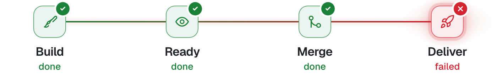</picture>

> [!CAUTION]
> **Deliver failed: fix 2 things, then re-run.**
>
> 1. main red after one fix.
> 2. reverted by revert PR #202.
>
> ```text
> /atelier https://github.com/mthines/reaper-mcp/pull/195
> ```

<sub> Atelier · head <code>4f1c2d9</code> · updated <relative-time datetime="2026-11-25T14:02:40.000Z">Nov 25, 2026 2:02pm</relative-time></sub>

<details>
<summary>Run details</summary>

| | Stage | Outcome | Head | When | Why |
| :-: | --- | --- | --- | --- | --- |
| ✅ | Build | done | `8e0b152` | <relative-time datetime="2026-11-25T13:02:10.000Z">Nov 25, 2026 1:02pm</relative-time> | aw Full: draft PR, review-loop converged |
| ✅ | Ready | done | `8e0b152` | <relative-time datetime="2026-11-25T13:27:43.081Z">Nov 25, 2026 1:27pm</relative-time> | reviewed (WARN, no findings); mergeable, no open threads; CI green at head |
| ✅ | Merge | done | `8e0b152` | <relative-time datetime="2026-11-25T13:31:05.000Z">Nov 25, 2026 1:31pm</relative-time> | squash-merged as 4f1c2d9; no user-visible diff |
| ❌ | Deliver | failed | `4f1c2d9` | <relative-time datetime="2026-11-25T14:02:40.000Z">Nov 25, 2026 2:02pm</relative-time> | main red after one fix; reverted by revert PR #202 |

**CI at `8e0b152`:** 🟢 1 required check ran and passed at 8e0b152 (`test`)
**Preflight:** `ok — 0 gaps`

Re-run `/atelier https://github.com/mthines/reaper-mcp/pull/195` to resume at the first incomplete stage.

</details>

<!-- atelier:v1:state {"v":1,"pr":"https://github.com/mthines/reaper-mcp/pull/195","stages":{"build":{"decision":"proceed","at":"2026-11-25T13:02:10.000Z","sha":"8e0b152270c509ca9634c6cd3363da87f98bd0ad","reason":"aw Full: draft PR, review-loop converged"},"ready":{"decision":"proceed","at":"2026-11-25T13:27:43.081Z","sha":"8e0b152270c509ca9634c6cd3363da87f98bd0ad","reason":"reviewed (WARN, no findings); mergeable, no open threads; CI green at head","ci":{"state":"green","ran":true,"head":"8e0b152270c509ca9634c6cd3363da87f98bd0ad","basis":"required","ran_checks":["test"],"reason":"1 required check ran and passed at 8e0b152"}},"merge":{"decision":"proceed","at":"2026-11-25T13:31:05.000Z","sha":"8e0b152270c509ca9634c6cd3363da87f98bd0ad","reason":"squash-merged as 4f1c2d9; no user-visible diff"},"deliver":{"decision":"failed","at":"2026-11-25T14:02:40.000Z","sha":"4f1c2d9a0b","reason":"main red after one fix; reverted by revert PR #202"}},"preflight":"PREFLIGHT: ok — 0 gaps","stage":"deliver","refusal":null} -->

<details>
<summary>Markdown source</summary>

````markdown
<!-- atelier:v1 -->
<picture><source media="(prefers-color-scheme: dark)" srcset="https://raw.githubusercontent.com/mthines/agent-skills/main/skills/workflow/atelier/assets/cards/done-done-done-failed-dark.png"></picture>

> [!CAUTION]
> **Deliver failed: fix 2 things, then re-run.**
>
> 1. main red after one fix.
> 2. reverted by revert PR #202.
>
> ```text
> /atelier https://github.com/mthines/reaper-mcp/pull/195
> ```

<sub> Atelier · head <code>4f1c2d9</code> · updated <relative-time datetime="2026-11-25T14:02:40.000Z">Nov 25, 2026 2:02pm</relative-time></sub>

<details>
<summary>Run details</summary>

| | Stage | Outcome | Head | When | Why |
| :-: | --- | --- | --- | --- | --- |
| ✅ | Build | done | `8e0b152` | <relative-time datetime="2026-11-25T13:02:10.000Z">Nov 25, 2026 1:02pm</relative-time> | aw Full: draft PR, review-loop converged |
| ✅ | Ready | done | `8e0b152` | <relative-time datetime="2026-11-25T13:27:43.081Z">Nov 25, 2026 1:27pm</relative-time> | reviewed (WARN, no findings); mergeable, no open threads; CI green at head |
| ✅ | Merge | done | `8e0b152` | <relative-time datetime="2026-11-25T13:31:05.000Z">Nov 25, 2026 1:31pm</relative-time> | squash-merged as 4f1c2d9; no user-visible diff |
| ❌ | Deliver | failed | `4f1c2d9` | <relative-time datetime="2026-11-25T14:02:40.000Z">Nov 25, 2026 2:02pm</relative-time> | main red after one fix; reverted by revert PR #202 |

**CI at `8e0b152`:** 🟢 1 required check ran and passed at 8e0b152 (`test`)
**Preflight:** `ok — 0 gaps`

Re-run `/atelier https://github.com/mthines/reaper-mcp/pull/195` to resume at the first incomplete stage.

</details>

<!-- atelier:v1:state {"v":1,"pr":"https://github.com/mthines/reaper-mcp/pull/195","stages":{"build":{"decision":"proceed","at":"2026-11-25T13:02:10.000Z","sha":"8e0b152270c509ca9634c6cd3363da87f98bd0ad","reason":"aw Full: draft PR, review-loop converged"},"ready":{"decision":"proceed","at":"2026-11-25T13:27:43.081Z","sha":"8e0b152270c509ca9634c6cd3363da87f98bd0ad","reason":"reviewed (WARN, no findings); mergeable, no open threads; CI green at head","ci":{"state":"green","ran":true,"head":"8e0b152270c509ca9634c6cd3363da87f98bd0ad","basis":"required","ran_checks":["test"],"reason":"1 required check ran and passed at 8e0b152"}},"merge":{"decision":"proceed","at":"2026-11-25T13:31:05.000Z","sha":"8e0b152270c509ca9634c6cd3363da87f98bd0ad","reason":"squash-merged as 4f1c2d9; no user-visible diff"},"deliver":{"decision":"failed","at":"2026-11-25T14:02:40.000Z","sha":"4f1c2d9a0b","reason":"main red after one fix; reverted by revert PR #202"}},"preflight":"PREFLIGHT: ok — 0 gaps","stage":"deliver","refusal":null} -->
````

</details>

## Every card

All 27 reachable states; the file name is `<build>-<ready>-<merge>-<deliver>-<theme>.png`.

**`done-pending-pending-pending`**

<picture><source media="(prefers-color-scheme: dark)" srcset="../../../assets/cards/done-pending-pending-pending-dark.png"></picture>

**`skipped-pending-pending-pending`**

<picture><source media="(prefers-color-scheme: dark)" srcset="../../../assets/cards/skipped-pending-pending-pending-dark.png">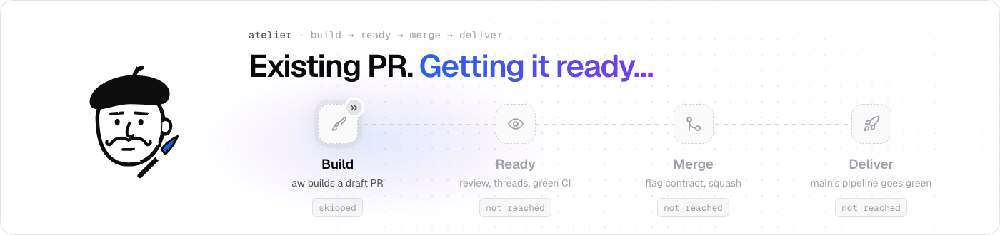</picture>

**`hold-pending-pending-pending`**

<picture><source media="(prefers-color-scheme: dark)" srcset="../../../assets/cards/hold-pending-pending-pending-dark.png"></picture>

**`failed-pending-pending-pending`**

<picture><source media="(prefers-color-scheme: dark)" srcset="../../../assets/cards/failed-pending-pending-pending-dark.png"></picture>

**`refuse-pending-pending-pending`**

<picture><source media="(prefers-color-scheme: dark)" srcset="../../../assets/cards/refuse-pending-pending-pending-dark.png"></picture>

**`done-done-pending-pending`**

<picture><source media="(prefers-color-scheme: dark)" srcset="../../../assets/cards/done-done-pending-pending-dark.png">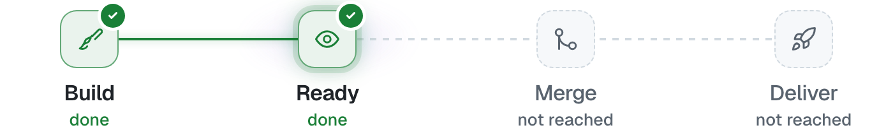</picture>

**`done-hold-pending-pending`**

<picture><source media="(prefers-color-scheme: dark)" srcset="../../../assets/cards/done-hold-pending-pending-dark.png"></picture>

**`done-failed-pending-pending`**

<picture><source media="(prefers-color-scheme: dark)" srcset="../../../assets/cards/done-failed-pending-pending-dark.png"></picture>

**`skipped-done-pending-pending`**

<picture><source media="(prefers-color-scheme: dark)" srcset="../../../assets/cards/skipped-done-pending-pending-dark.png"></picture>

**`skipped-hold-pending-pending`**

<picture><source media="(prefers-color-scheme: dark)" srcset="../../../assets/cards/skipped-hold-pending-pending-dark.png">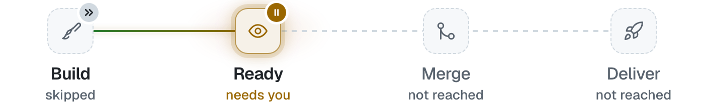</picture>

**`skipped-failed-pending-pending`**

<picture><source media="(prefers-color-scheme: dark)" srcset="../../../assets/cards/skipped-failed-pending-pending-dark.png">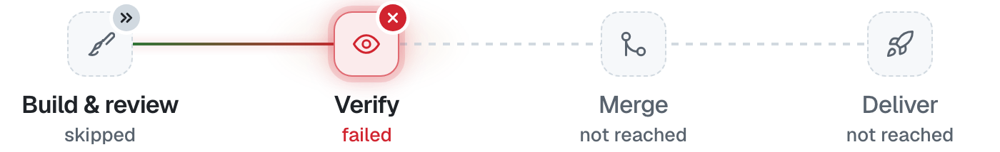</picture>

**`done-done-done-pending`**

<picture><source media="(prefers-color-scheme: dark)" srcset="../../../assets/cards/done-done-done-pending-dark.png"></picture>

**`done-done-hold-pending`**

<picture><source media="(prefers-color-scheme: dark)" srcset="../../../assets/cards/done-done-hold-pending-dark.png">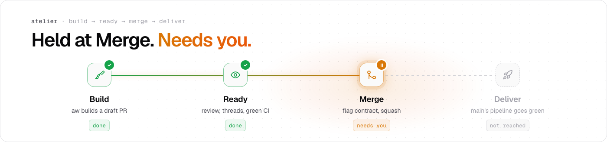</picture>

**`done-done-failed-pending`**

<picture><source media="(prefers-color-scheme: dark)" srcset="../../../assets/cards/done-done-failed-pending-dark.png">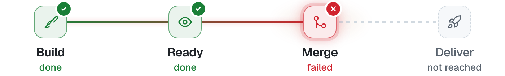</picture>

**`done-done-refuse-pending`**

<picture><source media="(prefers-color-scheme: dark)" srcset="../../../assets/cards/done-done-refuse-pending-dark.png"></picture>

**`skipped-done-done-pending`**

<picture><source media="(prefers-color-scheme: dark)" srcset="../../../assets/cards/skipped-done-done-pending-dark.png">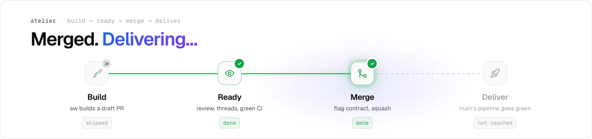</picture>

**`skipped-done-hold-pending`**

<picture><source media="(prefers-color-scheme: dark)" srcset="../../../assets/cards/skipped-done-hold-pending-dark.png">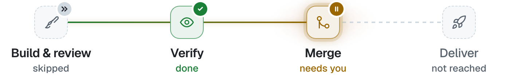</picture>

**`skipped-done-failed-pending`**

<picture><source media="(prefers-color-scheme: dark)" srcset="../../../assets/cards/skipped-done-failed-pending-dark.png">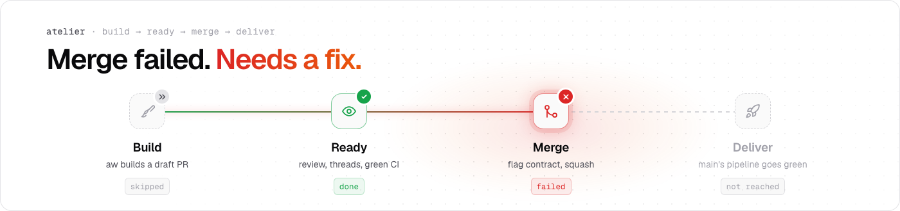</picture>

**`skipped-done-refuse-pending`**

<picture><source media="(prefers-color-scheme: dark)" srcset="../../../assets/cards/skipped-done-refuse-pending-dark.png"></picture>

**`done-done-done-done`**

<picture><source media="(prefers-color-scheme: dark)" srcset="../../../assets/cards/done-done-done-done-dark.png"></picture>

**`done-done-done-skipped`**

<picture><source media="(prefers-color-scheme: dark)" srcset="../../../assets/cards/done-done-done-skipped-dark.png">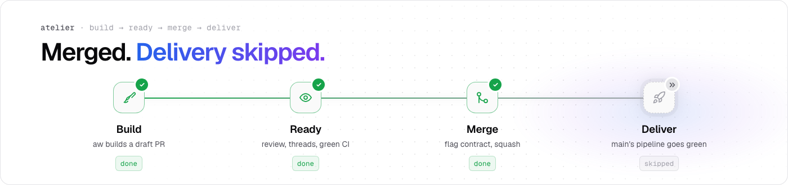</picture>

**`done-done-done-hold`**

<picture><source media="(prefers-color-scheme: dark)" srcset="../../../assets/cards/done-done-done-hold-dark.png"></picture>

**`done-done-done-failed`**

<picture><source media="(prefers-color-scheme: dark)" srcset="../../../assets/cards/done-done-done-failed-dark.png"></picture>

**`skipped-done-done-done`**

<picture><source media="(prefers-color-scheme: dark)" srcset="../../../assets/cards/skipped-done-done-done-dark.png">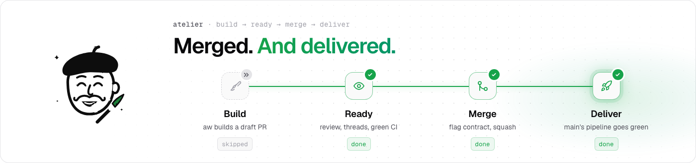</picture>

**`skipped-done-done-skipped`**

<picture><source media="(prefers-color-scheme: dark)" srcset="../../../assets/cards/skipped-done-done-skipped-dark.png">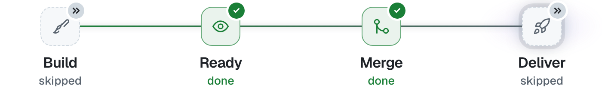</picture>

**`skipped-done-done-hold`**

<picture><source media="(prefers-color-scheme: dark)" srcset="../../../assets/cards/skipped-done-done-hold-dark.png"></picture>

**`skipped-done-done-failed`**

<picture><source media="(prefers-color-scheme: dark)" srcset="../../../assets/cards/skipped-done-done-failed-dark.png">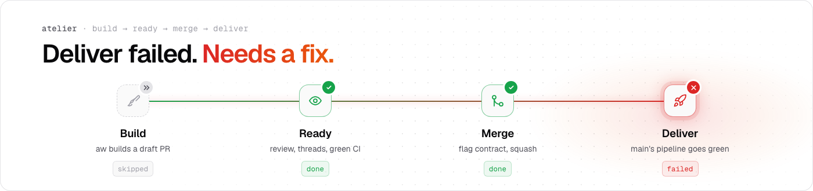</picture>

## Mascot

One mood per verdict; his brush tip takes the verdict's colour.

| working | ready | held | failed | refused | shipped |
| :-: | :-: | :-: | :-: | :-: | :-: |
|  |  |  |  | 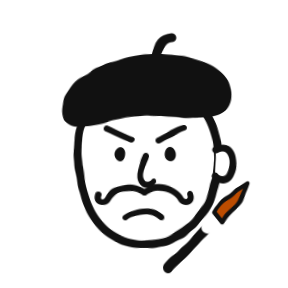 |  |
