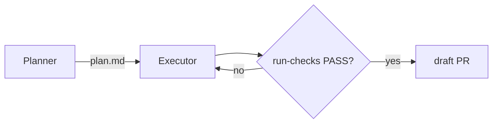

# Extended plan.md sections

Read when writing a Full-tier `plan.md`, or when File Changes has a `create` row.
The Core brief (Task, Requirements, Guardrails, Acceptance Criteria, Turn Cap, File Changes) is defined in [`../SKILL.md`](../SKILL.md#the-brief-core); this file defines everything else.

## Contents

- [Rule](#rule)
- [Trigger table](#trigger-table)
- [Section templates](#section-templates)
- [Validation](#validation)

## Rule

1. Write an Extended section only when the tier is Full **and** its trigger below holds.
2. Omit an Extended section whose trigger does not hold — never write an empty heading, `N/A`, or `None`.
3. Exception: `## Existing Code Survey` is required in every tier whenever File Changes has a `create` row (`confidence(plan)` rule #10).
4. Place Extended sections after `## File Changes`, in the order of the trigger table.

```markdown
<!-- ✗ Wrong — stubbed Extended section -->
## Risks
N/A

<!-- ✓ Right — the trigger does not hold, so the heading is absent -->
```

## Trigger table

| Section | Write when |
| --- | --- |
| `## Lessons applied` | One or more `aw-lessons` matched at intake |
| `## Decisions` | A choice was made between two or more viable options |
| `## Implementation Order` | The change has ordering constraints (a migration before its caller, a type before its users) |
| `## Background & Context` | The why is not obvious from `## Task`, or the domain is unfamiliar to a cold reader |
| `## Technical Approach` | The task spans 3+ components or packages, or the approach is not obvious from File Changes |
| `## Patterns to Follow` | The change must match a convention the executor would not infer from the files it edits |
| `## Edge Cases` | Error or edge cases exist that the Acceptance Criteria do not pin down |
| `## API / Interfaces` | A public interface, type signature, or config shape is defined or changed |
| `## Existing Code Survey` | File Changes has ≥ 1 `create` row (any tier — rule #10) |
| `## Tests` | Test design needs specific fixtures or a non-default strategy beyond the Acceptance Criteria |
| `## Dependencies` | A dependency is added, removed, or upgraded |
| `## Risks` | Complexity is HIGH, the change is a migration, or an operation is irreversible |
| `## Refinement Contract` | The caller attached one (for example `/fix-bug`'s CEGIS contract) — copy it verbatim |
| `## Progress Log` | Written by the executor on its first entry; the planner adds it only to log a plan iteration |

## Section templates

````markdown
## Decisions

| Decision | Alternatives Rejected | Rationale |
| -------- | --------------------- | --------- |
| {choice} | {option — why not}    | {why}     |

## Implementation Order

1. {atomic, verifiable step naming the file it touches}

## Technical Approach

<!-- Architecture, data flow, integration points. Never function bodies.
     Add a Mermaid diagram (flowchart / sequenceDiagram / stateDiagram-v2)
     only for 3+ components, a state-machine change, or a migration. -->



## Existing Code Survey

| Planned new unit | Searched for | Closest existing match | Verdict | Rationale |
| ---------------- | ------------ | ---------------------- | ------- | --------- |
| {new fn/module}  | {grep terms, def/ref lookups run} | {path:symbol or none} | {EXTEND \| WRAP \| BUILD NEW} | {why} |

## Edge Cases

| Edge Case | Handling |
| --------- | -------- |

## Tests

| Type | Test Case | File | Validates |
| ---- | --------- | ---- | --------- |

## Dependencies

- {package}@{version} [new]

## Risks

| Risk | Likelihood | Impact | Mitigation |
| ---- | ---------- | ------ | ---------- |

## Progress Log

- [{YYYY-MM-DDTHH:MM:SSZ}] Phase 1: plan version {N} written — {initial | user-iteration | auto-replan}
````

A `BUILD NEW` verdict is valid only when the "Searched for" cell lists the searches that came back empty.

## Validation

Check only the sections that are present:

| Section | Pass when |
| --- | --- |
| Decisions | Every row has a non-empty Rationale cell (`confidence(plan)` rule #6) |
| Implementation Order | Steps are numbered and each names a file |
| Existing Code Survey | Present whenever a `create` row exists; every row lists concrete searches |
| Technical Approach | Specific enough to implement cold; no pinned function bodies |
| Risks | Every row has likelihood, impact, and mitigation |
| Progress Log | Every entry starts with `[YYYY-MM-DDTHH:MM:SSZ]` (rule #7) |
